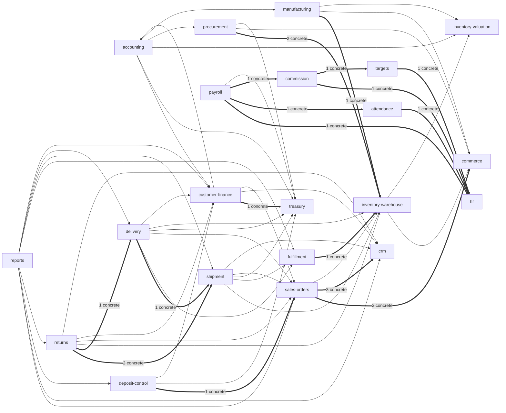

# DAII — Architecture Graph (as implemented)

Generated by `tools/assessment/arch-graph.js`, `cross-domain-imports.js`, `arch-graph-doc.js` from the **actual relative imports of production code** (`src/`, non-spec). Date 2026-10-11, commit `e9be53a`. Evidence: `evidence/arch-graph.json`, `evidence/cross-domain-imports.json`. Static analysis only (INFERRED where dynamic wiring is possible).

## 1. Inventory
- Production files 978; modules (domain/foundation folders + `database`, `health`…) 64; Nest modules (`*.module.ts`) 58; controllers 75; background schedulers 8.
- Entry points: `src/main.ts` (HTTP bootstrap, global ValidationPipe / exception filter / response envelope; serves SPA + `/api`), `src/app.module.ts` (composition root), 75 controllers (616 routes), schedulers (below), migrations CLI (`npm run migration:*`, `src/database/data-source.ts`), tools (`tools/build`, `deploy`, `release-sim`, `data-repair`, `maintenance`, `generators`, `validation`, `testing`, `assessment`).
- Schedulers (`setInterval`-based, inert under `NODE_ENV=test`):
  - `src/domains/accounting/application/closing-snapshot-recovery.scheduler.ts`
  - `src/domains/sales-orders/application/preliminary-hold-expiry.scheduler.ts`
  - `src/foundation/approval-engine/approval-expiry.scheduler.ts`
  - `src/foundation/company/membership-reconciliation.scheduler.ts`
  - `src/foundation/events/company-event-dispatcher.scheduler.ts`
  - `src/foundation/platform/support-access.scheduler.ts`
  - `src/foundation/release/backup-reconciliation.scheduler.ts`
  - `src/foundation/release/company-baseline-backup.scheduler.ts`

## 2. Domain-to-domain dependency graph (direct imports in production code)
Thin arrow = NestJS module wiring only; thick arrow = at least one **concrete service import** that bypasses the published contracts (`foundation/module-registry/contracts`).

Most depended-on domains (fan-in): treasury (7), inventory-warehouse (7), sales-orders (6), customer-finance (5), crm (5), hr (4), commerce (4), inventory-valuation (3). Most dependent (fan-out): reports (8), delivery (6), returns (6), accounting (5), shipment (5), customer-finance (4), payroll (4), deposit-control (3).

## 3. Concrete cross-domain service imports (contract bypass) — VERIFIED, file-level
| Importing file | Imported file |
|---|---|
| `src/domains/attendance/application/attendance.service.ts` | `src/domains/hr/application/hr.service.ts` |
| `src/domains/commission/application/commission.service.ts` | `src/domains/hr/application/hr.service.ts` |
| `src/domains/commission/application/commission.service.ts` | `src/domains/targets/application/target.service.ts` |
| `src/domains/customer-finance/application/payments.service.ts` | `src/domains/treasury/application/treasury.service.ts` |
| `src/domains/delivery/application/delivery.service.ts` | `src/domains/shipment/application/shipment.service.ts` |
| `src/domains/deposit-control/application/deposits.service.ts` | `src/domains/sales-orders/application/sales-orders.service.ts` |
| `src/domains/fulfillment/application/fulfillment.service.ts` | `src/domains/inventory-warehouse/application/inventory.service.ts` |
| `src/domains/manufacturing/application/work-order.service.ts` | `src/domains/inventory-warehouse/application/inventory.service.ts` |
| `src/domains/payroll/application/payroll.service.ts` | `src/domains/hr/application/hr.service.ts` |
| `src/domains/payroll/application/payroll.service.ts` | `src/domains/attendance/application/attendance.service.ts` |
| `src/domains/payroll/application/payroll.service.ts` | `src/domains/commission/application/commission.service.ts` |
| `src/domains/procurement/application/goods-receipt.service.ts` | `src/domains/inventory-warehouse/application/inventory.service.ts` |
| `src/domains/returns/application/returns.service.ts` | `src/domains/shipment/application/shipment.service.ts` |
| `src/domains/returns/application/returns.service.ts` | `src/domains/delivery/application/delivery.service.ts` |
| `src/domains/returns/application/shipment-returns.service.ts` | `src/domains/shipment/application/shipment.service.ts` |
| `src/domains/sales-orders/application/sales-orders.service.ts` | `src/domains/commerce/application/products.service.ts` |
| `src/domains/sales-orders/application/sales-orders.service.ts` | `src/domains/commerce/application/price-lists.service.ts` |
| `src/domains/sales-orders/application/sales-orders.service.ts` | `src/domains/crm/application/customers.service.ts` |
| `src/domains/targets/application/target.service.ts` | `src/domains/hr/application/hr.service.ts` |

Interpretation: these are real compile-time couplings between business domains (e.g. payroll → hr, attendance, commission). The ESLint boundary rule does not flag them (its header documents that same-level relative imports are not matched). Classification: **VERIFIED coupling; RISK, not defect** — behaviour is correct, but a change inside the imported service ripples across domains.

## 4. Platform → domain dependencies (layering inversions) — VERIFIED
| Platform module | Imports from domain | Files |
|---|---|---|
| foundation/database-registry | 21 domains | accounting(1), customer-finance(1), treasury(1), inventory-valuation(1), inventory-warehouse(1), procurement(1), sales-orders(1), shipment(1), returns(1), commerce(1), crm(1), fulfillment(1), delivery(1), deposit-control(1), manufacturing(1), hr(1), targets(1), attendance(1), commission(1), payroll(1), sales(1) |
| foundation/integrations | 4 domains | commerce(2), crm(2), sales-orders(2), inventory-warehouse(2) |

`foundation/database-registry/company-entity-registry.ts` lists every domain's entity set (registration inversion: a new domain must be added there); `foundation/integrations` calls four domain services directly. `foundation/testing` (test support) imports domain internals by design and is excluded from the count.

## 5. Cycles
- Module level: 1 strongly-connected component(s); the largest contains 44 of 64 modules — essentially every module, held together by the hubs `database` (entities/data-source) and `foundation/company`. VERIFIED (computed). Meaning: there is **no acyclic layering at module granularity**; modules cannot be extracted or built independently without breaking those hubs.
- File level: 2 cycles (sizes 4, 2). Samples: `foundation/configuration-engine/live-config-accessor.ts` ↔ `foundation/configuration-engine/configuration-engine.service.ts` ; `foundation/database-provisioning/database-provisioning.module.ts` ↔ `foundation/authentication/authentication.module.ts` ↔ `foundation/company/company.module.ts` ↔ `foundation/audit/audit.module.ts`. Small and local — VERIFIED.

## 6. Size by module (LOC, production)
domains/accounting: 15849 · database: 14987 · foundation/release: 7443 · domains/procurement: 4481 · foundation/module-registry: 4163 · foundation/company: 3948 · domains/inventory-warehouse: 3825 · domains/returns: 2742 · domains/shipment: 2315 · domains/manufacturing: 2112 · domains/customer-finance: 2011 · domains/sales-orders: 1962 · domains/commerce: 1844 · domains/attendance: 1656 · domains/treasury: 1600

## 7. What the graph says (and does not)
- VERIFIED: contracts exist and are the dominant integration mechanism (module wiring accounts for 57 of 79 cross-domain imports); 19 concrete service couplings and 21 registration inversions are the deviations.
- INFERRED: the single large cycle is structural (shared hubs), not accidental business coupling; confirm by removing hub edges and recomputing.
- NOT ASSESSED: runtime dependency injection beyond imports (dynamic `ModuleRef`, string tokens), and the frontend (`frontend/`, 181 files) architecture.
