

# دليل محرك التصنيع والتجربة العملية من البداية للنهاية

**الغرض:** شرح المحرك كما هو منفَّذ فعلًا (لا كما صُمِّم)، مدعومًا بتجربة حقيقية على بيئة التطوير من إنشاء المنتج حتى إقفال أمر الإنتاج، لتقييم سهولة الشاشات قبل أي قرار تحسين.
**القرّاء:** مالك مصنع / مدير إنتاج بلا خلفية برمجية. المصطلحات التقنية بين قوسين عند الحاجة.
**التاريخ:** 2026-10-25 · **الفرع:** `feature/manufacturing-engine-design` · **لا دمج ولا إصدار ولا نشر.**

---

## 0. كيف أُجريت التجربة (وما الذي لا تغطيه)

| البند | التفصيل |
|---|---|
| البيئة | واجهة Vite `http://127.0.0.1:5174` + خلفية NestJS `:3501`، على قاعدة التطوير نفسها (`daii_dev` + شركة Alpha `company_f3ea8a2e…`). المنفذان 3500/5173 كانا قد أُعيد تشغيلهما من نسخة قديمة تخص جلسة أخرى (انظر ت-م-01)، فأكملنا على 5174/3501. |
| الأسلوب | كل خطوة نُفِّذت **من شاشات التطبيق نفسها** (ملء الحقول والضغط على الأزرار الحقيقية عبر متصفح آلي). لم تُنفَّذ أي خطوة كتابة عبر SQL أو API لتبدو كأنها من الشاشة. استُخدمت قراءات SQL **للتحقق فقط**. |
| الصور | لقطات حقيقية بدقة عالية من المتصفح (مجلد `screenshots/`). الشاشات بالعربية (RTL). لم تُستخدم أي صور تصميمية. |
| بيانات التجربة | كلها بالبادئة `WT-` ومسجَّلة في §12 للتنظيف بأمان. **لم تُحذف** بعد (بانتظار أمرك). |
| ما لا تغطيه | لم تُجرَّب في المتصفح هذه المرة: البدائل (alternates)، الناتج المشترك/الثانوي، استرداد الخامة من الهالك، إعادة التشغيل/المرفوض/المعلّق. هذه مغطاة باختبارات آلية على قاعدة حقيقية (S1–S6) لكنها خارج التجربة الحية هنا، وهي مُعلَّمة «غير مُجرَّبة بصريًا» في §9. |

---

## 1. شرح المحرك بلغة بسيطة

### 1.1 ما وظيفته؟
محرك التصنيع (Manufacturing Engine) يحوّل **خامات في المخزن** إلى **منتج تام في المخزن**، ويحافظ أثناء ذلك على ثلاثة أشياء متطابقة دائمًا: **الكميات** (المخزون)، **التكلفة**، **القيود المحاسبية**. فكرته الأساسية: كل أمر إنتاج = **وعاء تكلفة واحد**؛ الخامات تدخله، والتكلفة تتجمع فيه، وعند الاستلام تتوزع على ما خرج منه. ينتهي الأمر ورصيد الوعاء **صفر**.

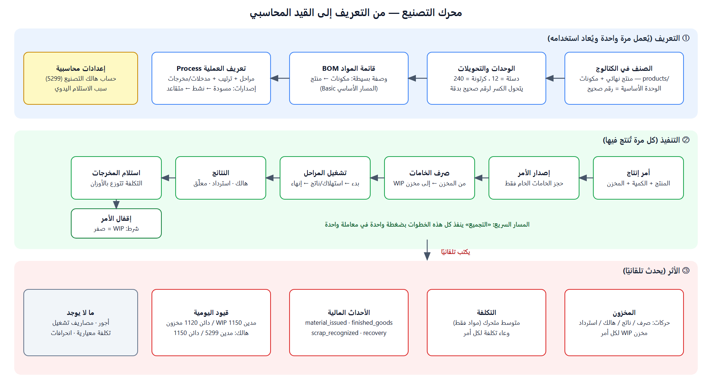

### 1.2 المصطلحات (عند أول ظهور)
| المصطلح | معناه العملي | أين تجده |
|---|---|---|
| **الصنف / المنتج** (Product) | أي شيء له كود: خامة، مكوّن، منتج وسيط، منتج نهائي. التسجيل في الكتالوج **لا يجعله قابلًا للتصنيع** بحد ذاته. | `/products` |
| **الوحدة الأساسية** (Base unit) | وحدة الصنف التي يُحسب بها المخزون، وهي **رقم صحيح دائمًا** (قطعة، جرام…). | حقل «الوحدة» في المنتج |
| **تحويل الوحدة** (Unit conversion) | «دستة = 12 قطعة». يسمح بكتابة 0.5 دستة فتتحول إلى 6 قطع بدقة، ويرفض أي ناتج غير صحيح. | بطاقة «وحدات الصنف» في `/manufacturing/boms` |
| **المكوّن** (Component) | صنف يدخل في تصنيع صنف آخر. | داخل BOM أو العملية |
| **قائمة المواد BOM** (الوصفة) | قائمة بسيطة: «لمبة واحدة = 6 شرائح + غلاف». **بلا مراحل.** وصفة واحدة نشطة لكل منتج. | `/manufacturing/boms` |
| **تعريف العملية** (Process Definition) | وصف **كيف** يُصنع المنتج: مراحل، ترتيبها، ما تستهلكه كل مرحلة وما تنتجه. له **إصدارات** (مسودة ← نشط ← متقاعد) وواحد نشط فقط لكل منتج. | `/manufacturing/processes` |
| **المرحلة** (Operation) | خطوة داخل تعريف العملية (تصنيع، تجميع، فحص…). قد تكون اختيارية أو قابلة للتكرار. | داخل التعريف |
| **المنتج الوسيط** (Intermediate) | شيء يُصنع في مرحلة ويُستهلك في مرحلة لاحقة **داخل الأمر نفسه** (لا يدخل المخزن). | داخل التعريف |
| **أمر الإنتاج** (Work Order) | تنفيذ فعلي لكمية محددة. يأخذ لقطة من التعريف وقت الإصدار. | `/manufacturing/work-orders` |
| **مخزن الإنتاج تحت التشغيل** (WIP) | مخزن افتراضي **ينشأ تلقائيًا لكل أمر**، تنتقل إليه الخامات المصروفة. | تلقائي |
| **تشغيل المرحلة** (Operation Run) | محاولة تنفيذ مرحلة داخل أمر: بدء ← تسجيل استهلاك/ناتج ← إنهاء. المراحل القابلة للتكرار لها عدة تشغيلات. | لوحة «تنفيذ العملية» |
| **الهالك / الاسترداد / التتبع** | نتائج الإنتاج غير الجيدة: هالك (يُحمَّل على حساب مصروف)، استرداد خامة من الهالك، وحدات معلّقة/مرفوضة/إعادة تشغيل. | لوحة «نتائج الإنتاج» |
| **الحدث المالي** (Financial Event) | رسالة داخلية تتحول إلى قيد يومية. إذا نقصت إعداداتها تُرفض ولا يُرحَّل قيد ناقص. | `/accounting/financial-events` |

### 1.3 التعريف مرة واحدة والاستخدام مرات
تعريف العملية (أو الـBOM) يُكتب **مرة واحدة**. كل أمر إنتاج جديد يستخدم الإصدار **النشط وقت الإنشاء** ويحتفظ بنسخته؛ تغيير التعريف لاحقًا (بإصدار جديد) **لا يمس الأوامر القائمة**. الإصدار النشط **لا يُعدَّل**: تنسخه إلى مسودة جديدة وتفعّلها فيتقاعد القديم.

### 1.4 الارتباط بالمخزون والمشتريات والتكلفة والحسابات
- **المشتريات / المخزون:** الخامات تدخل المخزن من المشتريات (استلام بضاعة) أو من استلام يدوي. المحرك لا يشتري؛ يستهلك ما في المخزن. المنتج التام يدخل **مخزن الأمر** (المستودع المختار عند الإنشاء).
- **التكلفة:** متوسط متحرك (Moving Average) للخامات **فقط**. لا أجور ولا مصاريف تشغيل ولا تكلفة معيارية (قرار معتمد).
- **الحسابات:** صرف الخامات (مدين WIP 1150 / دائن مخزون 1120)، استلام المنتج (مدين 1120 / دائن 1150)، الهالك (مدين مصروف الهالك / دائن 1150).

### 1.5 ما الذي يفعله المحرك تلقائيًا وما الذي يحتاج المستخدم؟
| تلقائي | يحتاج إدخال/ضغط من المستخدم |
|---|---|
| إنشاء مخزن WIP للأمر · حجز الخامات عند الإصدار · حركات المخزون · حساب التكلفة · الأحداث المالية والقيود · قيمة المراحل · منع التجاوز (استهلاك فوق الخطة/المصروف) · منع الإقفال والـWIP غير صفر | إنشاء المنتجات · الإعدادات المحاسبية · استلام الخامات · تعريف الوحدات/BOM/العملية · إنشاء الأمر · الإصدار · صرف الخامات · بدء/تسجيل/إنهاء المراحل · تسجيل الهالك · استلام المخرجات · الإقفال |

### 1.6 المسار الأساسي (Basic Profile) مقابل المسار العام (متعدد العمليات)
| | الأساسي | العام (Process) |
|---|---|---|
| التعريف | BOM (قائمة مكونات) + اختياريًا «مسار تشغيل» (Routing) | تعريف عملية بإصدارات |
| المراحل | تسلسل فقط، بلا مدخلات/مخرجات لكل مرحلة | رسم بياني: تتابع، فروع متوازية، انتظار، اختيارية، تكرار |
| المخرجات | منتج واحد | منتج رئيسي + مشترك + ثانوي + وسيط |
| الإنشاء | نموذج «إنشاء أمر إنتاج» | بطاقة «أمر تشغيل بعملية» |
| الاستلام | «استلام منتج تام» | «استلام المخرجات النهائية (توزيع بالأوزان)» |
| الحالة | **لم يتغير سلوكه** (محمي باختباراته) | جديد |

---

## 2. خريطة الشاشات

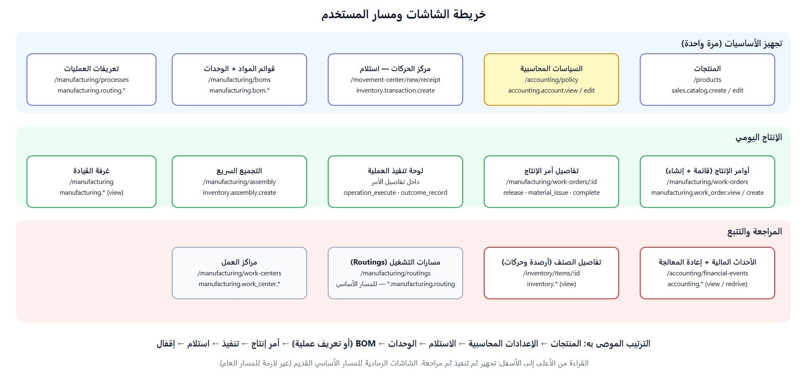

| # | الشاشة (عربي / English) | المسار | الغرض | الصلاحيات (permission) |
|---|---|---|---|---|
| 1 | المنتجات / Products | `/products` | إنشاء الأصناف | `sales.catalog.create` / `edit` |
| 2 | السياسات المحاسبية / Accounting Policy | `/accounting/policy` | حسابات القيود التلقائية | `accounting.account.view` / `edit` |
| 3 | مركز الحركات — استلام / Movement Center | `/movement-center/new/receipt` ، `/movement-center/:id` | إدخال خامات للمخزن | `inventory.transaction.create` |
| 4 | قوائم المواد (الوصفات) + وحدات الصنف / BOMs & Units | `/manufacturing/boms` | الوصفة والتحويلات | `manufacturing.bom.view/create/edit/delete` |
| 5 | تعريفات العمليات / Process Definitions | `/manufacturing/processes` | الإصدارات والمراحل | `manufacturing.routing.view/create/edit/delete` (مُعاد استخدامها) |
| 6 | أوامر الإنتاج / Work Orders | `/manufacturing/work-orders` | القائمة + إنشاء أساسي/عام | `manufacturing.work_order.view` / `create` |
| 7 | تفاصيل أمر الإنتاج / Work Order Detail | `/manufacturing/work-orders/:id` | كل دورة حياة الأمر | `…release` `…material_issue` `…material_return` `…finished_goods_receive` `…outcome_record` `…hold` `…complete` `…cancel` `…operation_execute` |
| 8 | التجميع / Quick Assembly | `/manufacturing/assembly` | تجميع بضغطة واحدة | `inventory.assembly.create` |
| 9 | الأحداث المالية / Financial Events | `/accounting/financial-events` | المرفوض وإعادة المعالجة | `accounting.financial_event.view` / `accounting.journal.post` (للإعادة) |
| 10 | تفاصيل الصنف / Item Details | `/inventory/items/:id` | الأرصدة والحركات | صلاحيات المخزون |
| 11 | غرفة القيادة / Manufacturing Cover | `/manufacturing` | مؤشرات واختصارات | `manufacturing.*` (عرض) |
| 12 | مسارات التشغيل / Routings · مراكز العمل / Work Centers | `/manufacturing/routings` ، `/manufacturing/work-centers` | المسار الأساسي القديم | `manufacturing.routing.*` / `manufacturing.work_center.*` |

### 2.1 شاشات المراجعة والمسار الأساسي (باختصار)

| الشاشة | متى تفتحها | ما فيها | ما تحفظه |
|---|---|---|---|
| **غرفة القيادة** `/manufacturing` | نقطة البداية اليومية | مؤشرات (قوائم المواد، المسارات، مراكز العمل، أوامر مفتوحة، قيمة WIP) واختصارات | لا شيء (قراءة) |
| **الأحداث المالية** `/accounting/financial-events` | عند الشك في قيد، أو لمعالجة «مرفوض» | تصفية بالحالة (مستلم/مُعيَّن/مُرحَّل/مرفوض/مُتجاهَل)، سبب الرفض، زر «إعادة معالجة» للمرفوض | «إعادة المعالجة» تعيد محاولة الترحيل بعد إصلاح الإعداد |
| **تفاصيل الصنف** `/inventory/items/:id` | للتحقق من الرصيد والحركات | رصيد الصنف لكل مخزن وسجل الحركات | لا شيء |
| **مسارات التشغيل (Routings)** `/manufacturing/routings` | مسار أساسي قديم فقط | مراحل مرتبة + مركز عمل لكل مرحلة (بلا مواد) | `routings`، `routing_operations` |
| **مراكز العمل** `/manufacturing/work-centers` | تعريف مراكز تُستخدم في Routings (واختياريًا في العمليات) | كود/اسم/حالة | `work_centers` |

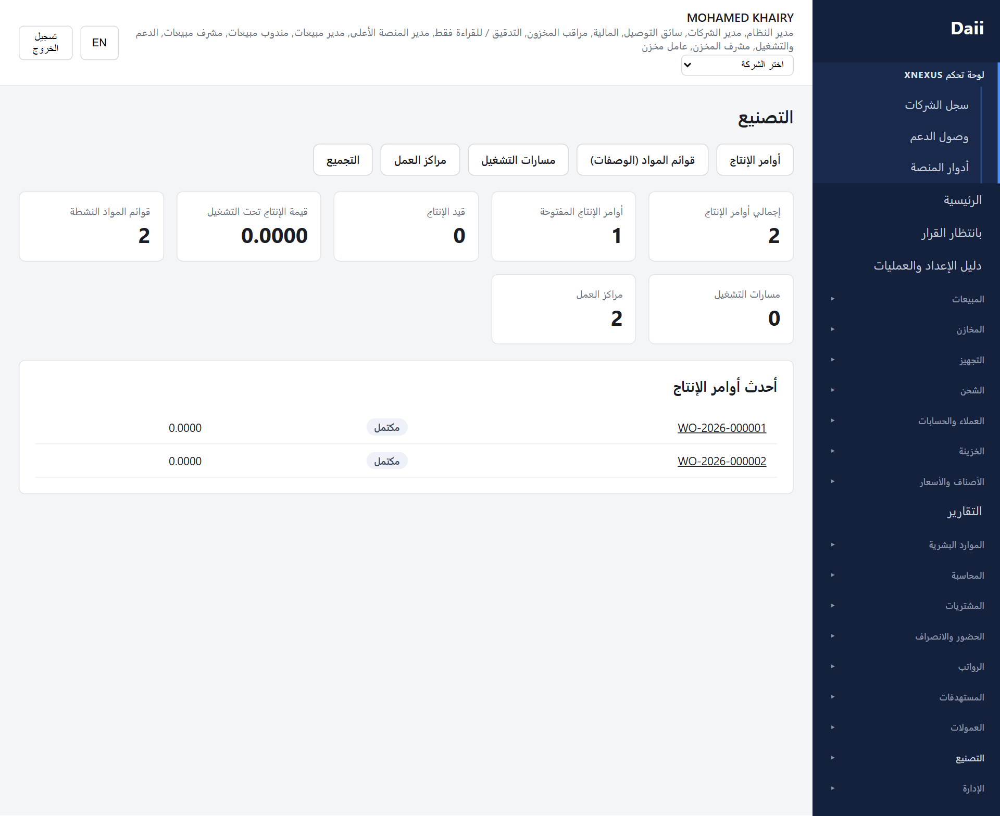
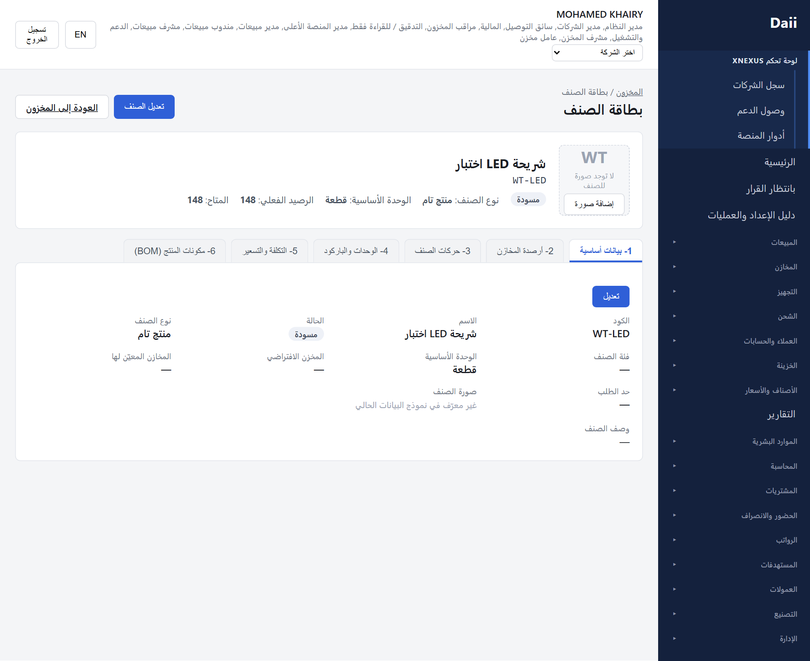
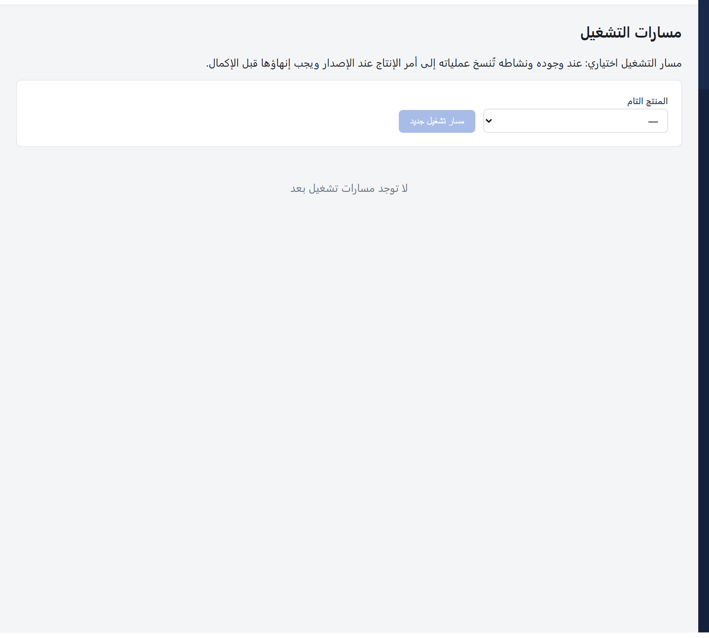
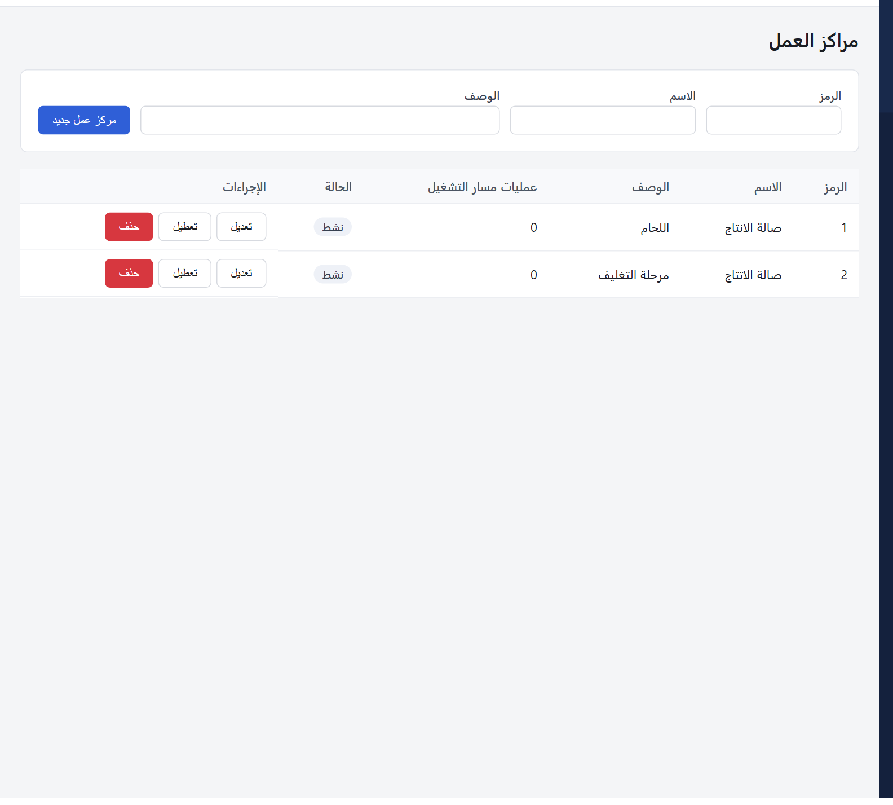

كل الشاشات تتطلب أن تكون **الشركة مختارة** (Alpha هنا) وأن تكون وحدة التصنيع مفعّلة للشركة.

---

## 3. تجهيز المنتج والخامات من الصفر (الجزء أ)

### 3.1 الفرق بين «تسجيل المنتج» و«تعريف طريقة تصنيعه»
تسجيل المنتج في الكتالوج (`/products`) يعني فقط أنه موجود بكود واسم وسعر ووحدة. **لا يصبح قابلًا للإنتاج** إلا بعد: (أ) وصفة BOM نشطة (المسار الأساسي) **أو** تعريف عملية نشط (المسار العام). الخطوتان منفصلتان وفي شاشتين مختلفتين.

### 3.2 شاشة المنتجات — `/products`

| الحقل | المعنى | ملاحظات |
|---|---|---|
| رمز المنتج | الكود (SKU) | اختياري: يُولَّد تلقائيًا (PRD-000001) · **لا يُقبل كود مكرر** |
| الاسم | اسم الصنف | مطلوب |
| سعر الوحدة | سعر البيع المرجعي | لا علاقة له بالتكلفة |
| الوحدة | الوحدة الأساسية (نص حر) | مثل «قطعة». **نص حر وليس قائمة** (ت-م-04) |
| المخزن الابتدائي/الافتراضي | اختياري | لا يؤثر على التصنيع |
| زر «إنشاء» | يحفظ الصنف | يُنشأ بحالة **مسودة (draft)** — وما زال صالحًا للاستخدام في كل ما يلي (في قائمة المنتجات زر «تفعيل» لكل مسودة، لكن معنى الحالة غير مشروح) |

**ما يُحفظ:** صف في `products` + بند في قائمة الأسعار. لا حركة مخزون ولا قيد. **الخطوة التالية:** إعداد السياسات (§3.3) ثم الاستلام.
**أنشأنا:** WT-LAMP (المنتج النهائي)، WT-LED (شريحة)، WT-CASE (غلاف)، WT-MODULE (وحدة وسيطة) — المعرّفات في §12.

### 3.3 الإعدادات المحاسبية — `/accounting/policy`
قبل أول استلام يدوي وقبل أول هالك لابد من إعدادين (الصفحة طويلة: 18 إعدادًا، ابحث عن العنوانين):

| الإعداد | وظيفته | ما فعلناه |
|---|---|---|
| حساب خسارة هالك التصنيع `accounting.manufacturing_scrap_loss_account_code` | الطرف المدين عند تسجيل هالك. **بدونه يُرفض القيد.** | اخترنا 5299 (مصروفات متنوعة) ثم «حفظ» ← تظهر «صالح» |
| أسباب الاستلام اليدوي `accounting.inventory_manual_receipt_reason_accounts` | قائمة بالأسباب المسموحة للاستلام اليدوي + حساب مقابل لكل سبب (حقوق ملكية/إيراد/التزام) | أضفنا السبب `wt_initial_stock` مقابل 3101 (رأس المال) |

**ما يُحفظ:** قيمة في إعدادات التثبيت (`config_values`) تسري على **كل الشركات** (التحقق من صلاحية الحساب يتم على الشركة الحالية فقط). **تنبيه:** هذه الإعدادات حُذفت من نسخة قديمة أعادت التشغيل (انظر ت-م-01).

### 3.4 استلام الخامات — مركز الحركات `/movement-center/new/receipt`
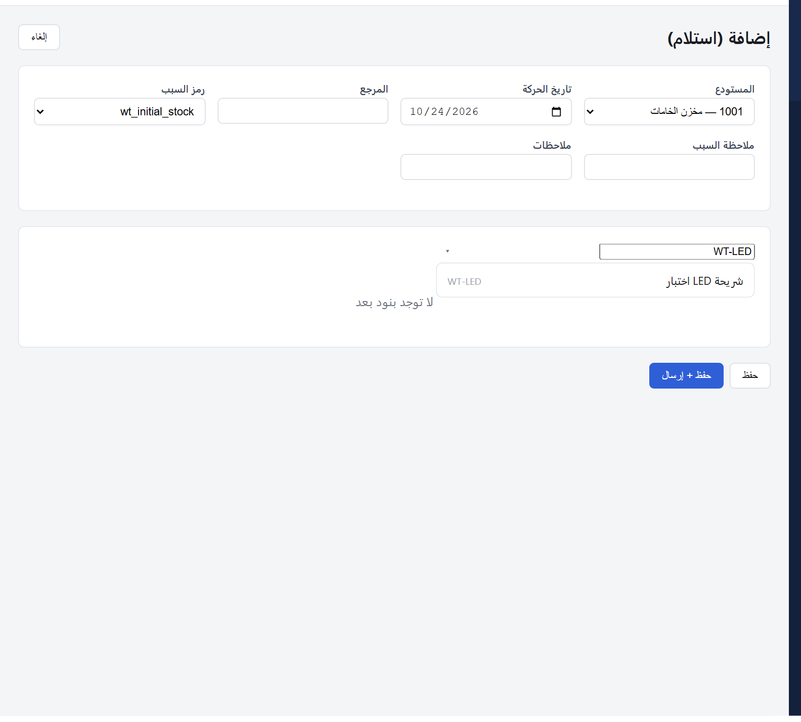

| الحقل/الزر | المعنى |
|---|---|
| المستودع | مخزن الخامات (1001) |
| تاريخ الحركة / المرجع | التاريخ الافتراضي اليوم · المرجع نص اختياري |
| رمز السبب | **من قائمة §3.3** (فارغة إن لم يُعرَّف سبب) |
| ملاحظة السبب / ملاحظات | نص حر |
| بنود الطلب | ابحث باسم المنتج، اختر، ثم **الكمية وسعر الوحدة** (سعر الوحدة = التكلفة التي ستدخل المتوسط المتحرك) |
| «حفظ» / «حفظ + إرسال» | الأولى مسودة؛ الثانية تُرحِّل المستند فورًا |

نفّذنا: WT-LED **200 × 2.00** و WT-CASE **100 × 5.00** ← «حفظ + إرسال» فتحوّل إلى مستند **WH-IN-2026-000001** بحالة «مرحّل»:

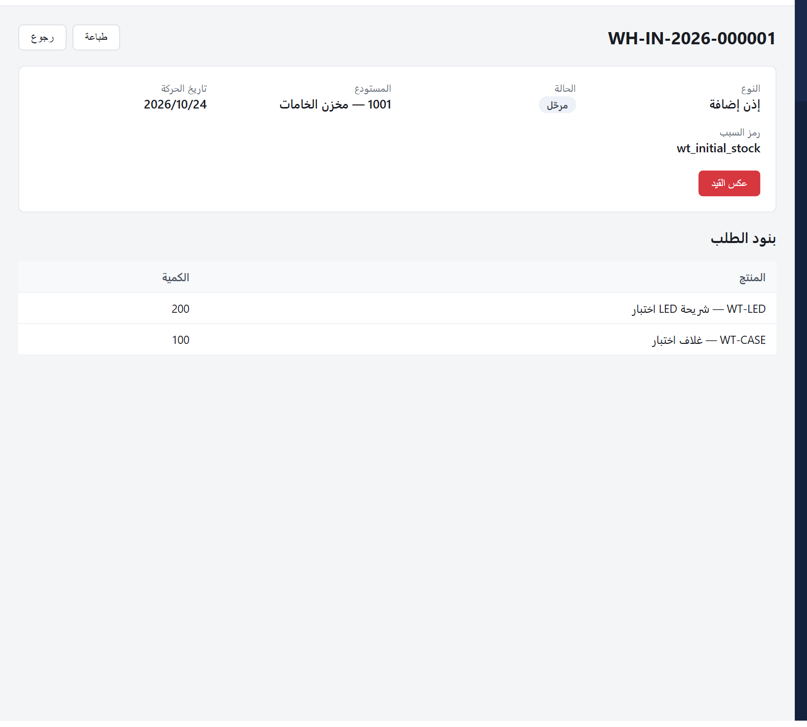

**ما يُحفظ وما يتولد:** مستند + بنود، حركتا مخزون (+200 و+100)، تقييم المتوسط المتحرك، **حدثان ماليان ← قيدان:** مدين 1120 مخزون 400 / دائن 3101 400، ومدين 1120 500 / دائن 3101 500 (JV-2026-000012/13). **يمنع الحفظ:** رمز سبب غير معرَّف أو لم يُختر، أو بند بلا كمية. **التالي:** الوحدات والـBOM.

---

## 4. الوحدات والوصفة BOM — `/manufacturing/boms` (الجزء ب)

### 4.1 وحدات الصنف وتحويلات العبوات
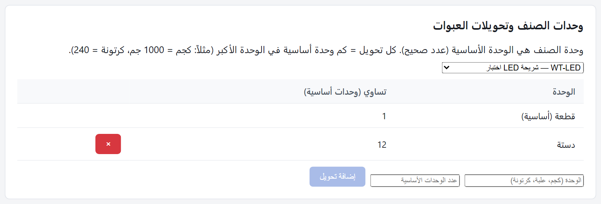

اختر الصنف (WT-LED)، اكتب اسم الوحدة (**دستة**) وعدد الوحدات الأساسية (**12**)، «إضافة تحويل». الوحدة الأساسية «قطعة = 1» ثابتة. القاعدة: **كل تحويل رقم صحيح ≥ 2**، ولا يُقبل تكرار نفس الاسم، ولا يُقبل اسم الوحدة الأساسية نفسها. يُحفظ في `product_unit_conversions`. لا حركة ولا قيد.

### 4.2 إنشاء الوصفة
اختر المنتج التام (WT-LAMP) ← «وصفة جديدة» ← لكل مكوّن: **المكوّن + الكمية لكل وحدة + الوحدة** (القائمة تعرض الأساسية وتحويلاتها) ← «إضافة مكون» ← «حفظ».

مثالنا: **WT-LED = 0.5 دستة** + **WT-CASE = 1 قطعة**. النظام حوّل 0.5 × 12 = **6 قطع** (يرفض ما لا يتحول لرقم صحيح كـ 0.0005 كجم من جرام). النتيجة المعروضة:

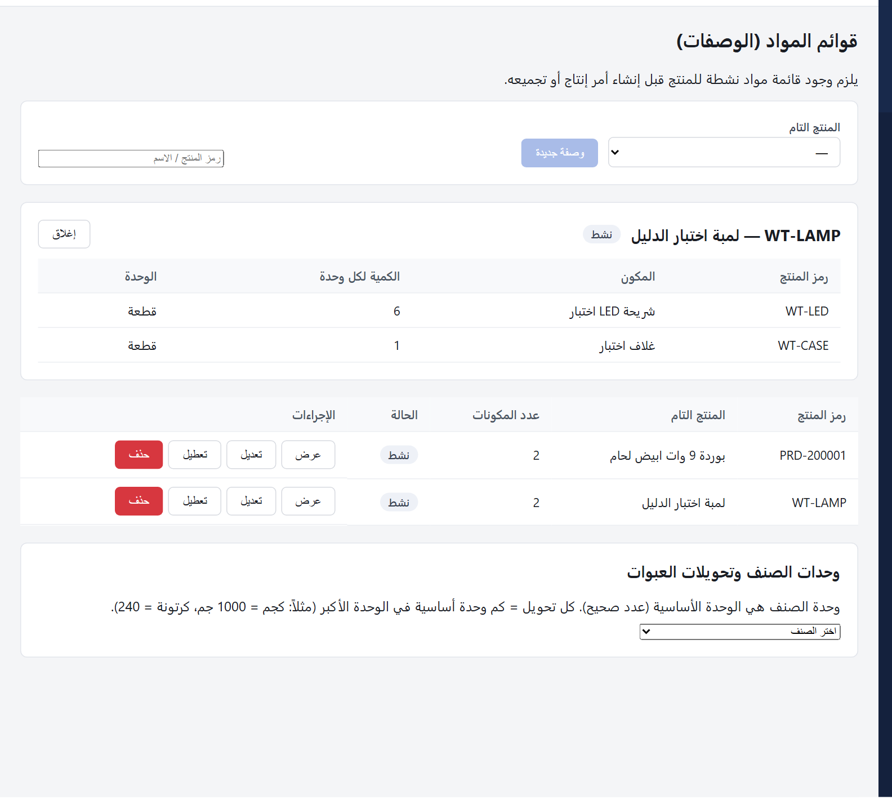

| الحساب لإنتاج 10 لمبات (BOM) | الكمية بالوحدة الأساسية |
|---|---|
| WT-LED | 6 × 10 = **60** قطعة |
| WT-CASE | 1 × 10 = **10** قطعة |

**ما يُحفظ:** `bill_of_materials` + `bom_components` (الكمية بالوحدة الأساسية فقط). **يتحقق النظام من:** المكوّن موجود، الكمية رقم صحيح موجب، لا تكرار للمكوّن، لا مكوّن = المنتج نفسه. **المنتج الوسيط:** الـBOM **لا يدعم** الوسيط المتعدد المستويات — لتصنيع وسيط ثم استخدامه تُنشئ BOM وأمرًا لكل مستوى (وحدة ← عبوة ← كرتونة)، أو تستخدم تعريف عملية.

**إذا تغيرت الوصفة:** الأوامر القائمة تحتفظ بلقطتها وقت **الإصدار**؛ التعديل يؤثر فقط على أوامر لم تُصدر بعد.
**قيود الإصدار الحالي:** وصفة واحدة لكل منتج (بلا إصدارات)، بلا بدائل، بلا مستويات؛ شاشة التعديل **تعيد فتح الوصفة بالوحدة الأساسية** (6 قطع) لا بما كتبت (0.5 دستة) — ت-م-05.

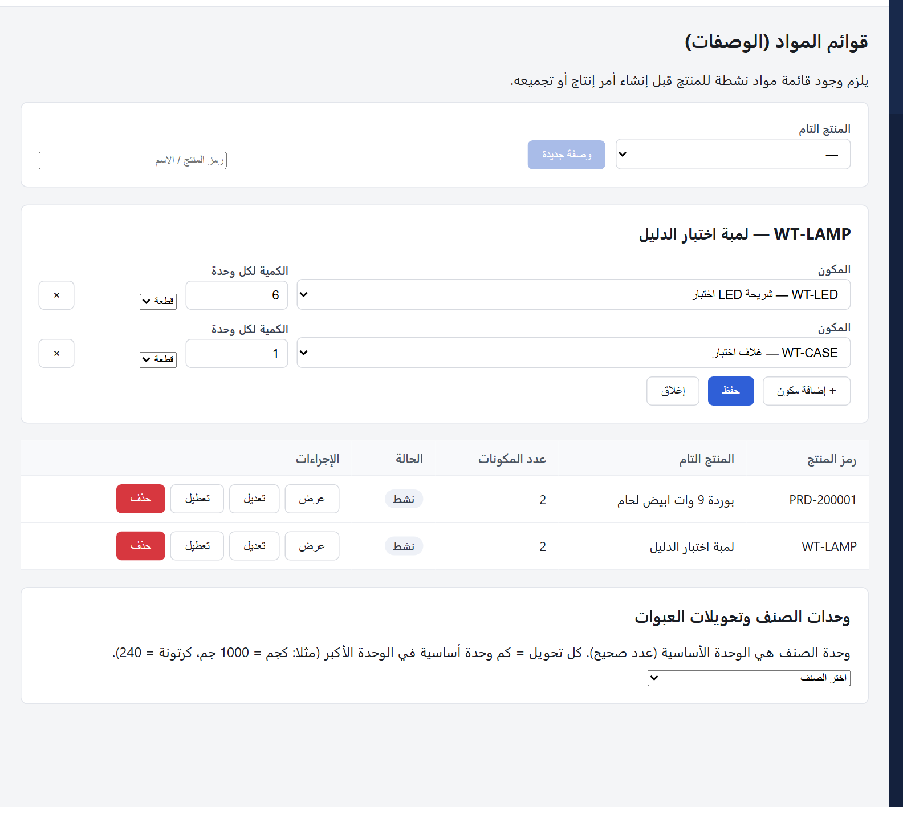

---

## 5. تعريف العملية وأمر الإنتاج (الجزء ج + د)

### 5.1 تعريف العملية — `/manufacturing/processes`
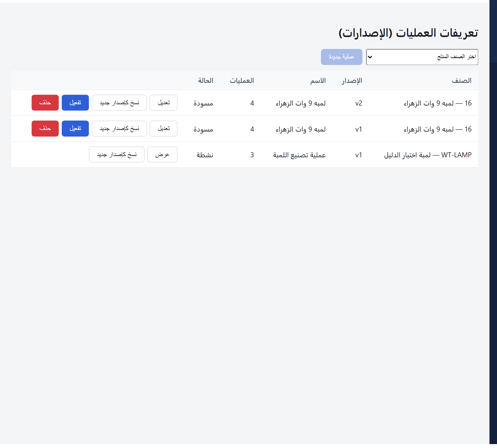

**الخطوات:** اختر الصنف المنتَج ← «عملية جديدة» ← املأ الأقسام الأربعة ← «حفظ المسودة» ← (يظهر زر) «حفظ وتفعيل».

| القسم | الحقول | القواعد التي يفرضها النظام |
|---|---|---|
| **العمليات (عقد المخطط)** | الرمز (حروف/أرقام/-/_ حتى 32) · الاسم · النوع (من كتالوج قابل للتخصيص: تشغيل/تجميع/تعبئة/فحص جودة/تفكيك/إعادة تشغيل) · الترتيب (للعرض فقط) · **اختيارية** · **أقصى مرات** (التكرار 1–50) | لا تكرار للرمز · النوع معرَّف ونشط |
| **الترتيب (من ← إلى)** | كل سطر = مرحلة تسبق أخرى. **فرعان متوازيان** = مرحلتان بنفس السابقة. **دمج** = مرحلة لها أكثر من سابقة (تنتظر الجميع) | يُرفض الدوران (cycle) والارتباط بالنفس. التكرار يتم بـ«أقصى مرات» لا بحلقة |
| **المواد المستهلكة** | المرحلة · المكوّن · الكمية (**قطع صحيحة**) · مجموعة بدائل | مجموعة البدائل تحتاج خيارين على الأقل (واحد يُختار عند إنشاء الأمر) |
| **المخرجات** | المرحلة · المنتج · الكمية · الدور (رئيسي/مشترك/ثانوي) · **وسيط** · **الوزن** | وسيط: لابد أن يُستهلك في مرحلة **لاحقة** · عند التفعيل لابد من مخرج نهائي رئيسي = منتج التعريف نفسه ووزن > 0 |

**المثال المُنفَّذ (إصدار v1):**

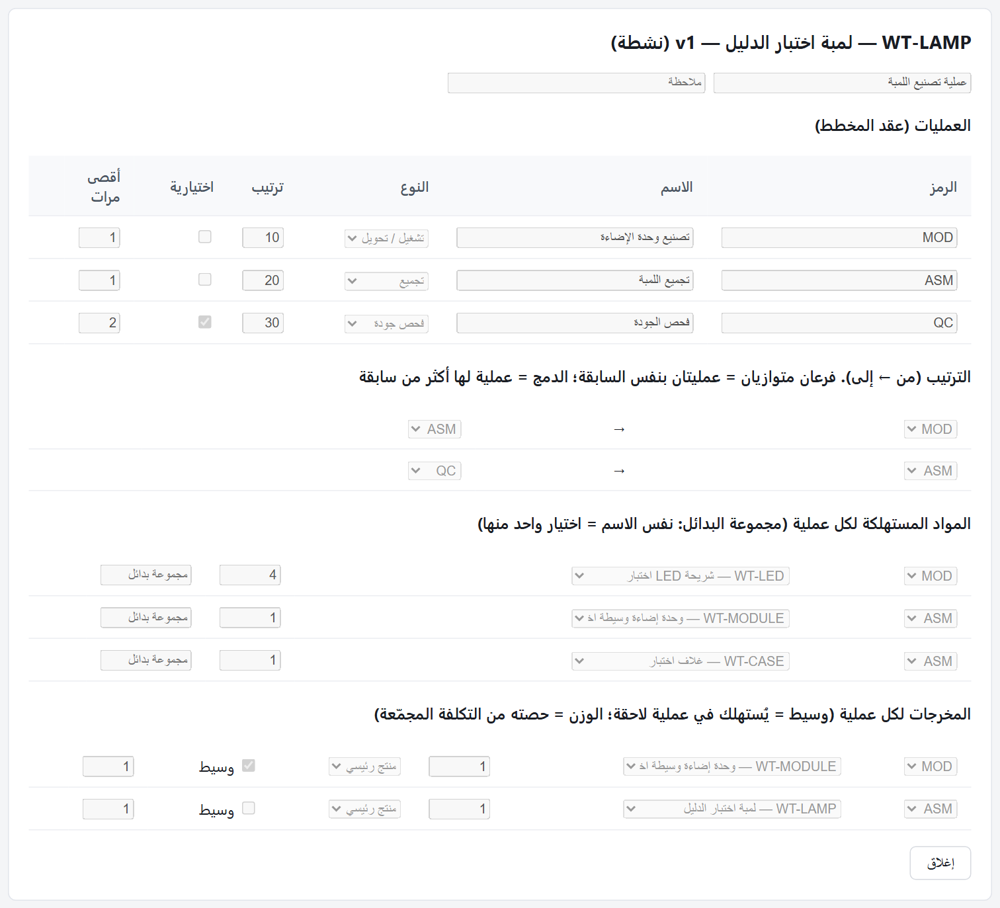

| المرحلة | تستهلك لكل لمبة | تنتج لكل لمبة | ملاحظات |
|---|---|---|---|
| MOD تصنيع وحدة الإضاءة (تشغيل) | WT-LED × 4 | WT-MODULE × 1 (وسيط) | |
| ASM تجميع اللمبة (تجميع) | WT-MODULE × 1 + WT-CASE × 1 | WT-LAMP × 1 (نهائي) | تنتظر MOD |
| QC فحص الجودة (فحص) | — | — | اختيارية، حتى مرتين، تنتظر ASM |

**الفرق بين التعريف والأمر:** التعريف قالب مُعاد الاستخدام (لا يحرك مخزونًا ولا قيدًا). الأمر **ينفّذه** لكمية محددة. **التفعيل:** يجعل الإصدار الوحيد النشط ويُقاعد السابق، وبعدها **لا يُعدَّل** (تنسخه). **ما يُحفظ:** 5 جداول `mfg_process_*`. **تنبيه:** يعرض الإصدار النشط **دون عمود عناوين** للمواد/المخرجات (ت-ت-06).

> ملاحظة المثال: الـBOM (6 شرائح) والعملية (4 شرائح) **مختلفان عمدًا** لتوضيح أن لكل مسار تعريفه؛ الأمر يستخدم ما اخترت عند إنشائه.

### 5.2 إنشاء أمر الإنتاج — `/manufacturing/work-orders`
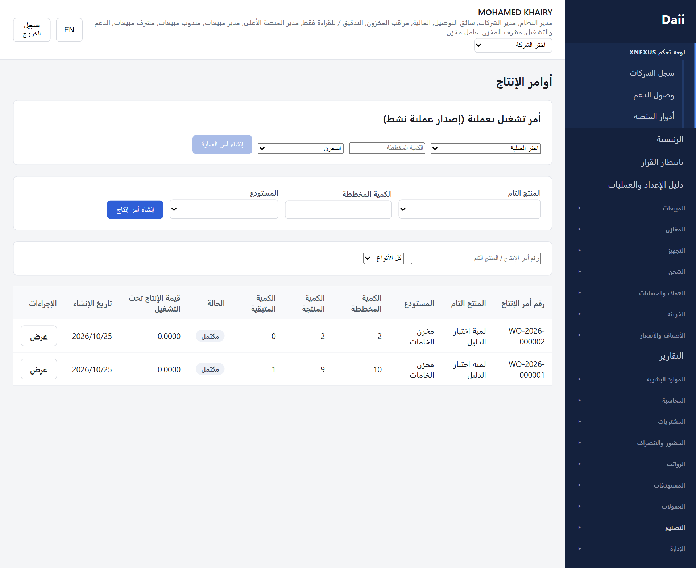

الصفحة تعرض **مسارين**: بطاقة «**أمر تشغيل بعملية (إصدار عملية نشط)**» أعلاها، ونموذج «إنشاء أمر إنتاج» الأساسي (BOM) أسفلها.

| حقل البطاقة العامة | المعنى |
|---|---|
| اختر العملية | تظهر **الإصدارات النشطة فقط** |
| الكمية المخططة | عدد وحدات المنتج النهائي (صحيح موجب) |
| المخزن | مستودع التنفيذ (يُستبعد مخزن WIP) — **والمنتج التام سيُستلم فيه** (ت-و-02) |
| بدائل (إن وُجدت) | اختيار صريح لكل مجموعة بدائل — لا يوجد اختيار افتراضي |
| «إنشاء أمر العملية» | ينشئ الأمر **مسودة** ويفتح تفاصيله |

**ما يُنسخ للأمر:** رقم الإصدار النشط واختيارات البدائل (لا ينسخ المراحل؛ الإصدار النشط غير قابل للتعديل فتبقى مرجعًا ثابتًا). **ما يُحفظ:** `work_orders` (+ `processVersionId`) + حالة دورة الحياة. لا حركة ولا قيد. أنشأنا **WO-2026-000001** لـ 10 لمبات.

### 5.3 تفاصيل الأمر — `/manufacturing/work-orders/:id`
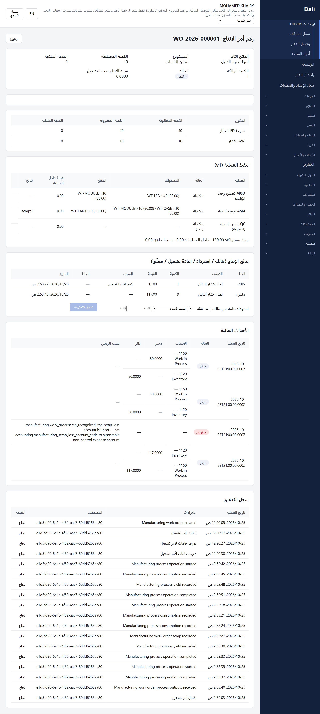

| القسم | وظيفته |
|---|---|
| بطاقة الملخص | المنتج، المستودع، **المخططة / المنتجة / الهالكة**، **قيمة الإنتاج تحت التشغيل**، **الحالة** |
| شريط الإجراءات | مسودة: «إصدار» · «إلغاء». قيد التنفيذ: «إيقاف مؤقت» · «إكمال» |
| جدول المكونات | لكل خامة: المطلوبة / المصروفة / المتبقية + خانة **صرف مواد** (+ «تأكيد») وخانة **إرجاع مواد** |
| «استلام منتج تام» | الاستلام **الأساسي** بمنتج واحد (انظر ت-و-01) |
| **تنفيذ العملية (v1)** | جدول المراحل ولوحة التسجيل (§5.4) + «استلام المخرجات النهائية» |
| نتائج الإنتاج | جدول النتائج + نماذج: تسجيل هالك · استرداد خامة من هالك · تتبع وحدات (معلّق/إعادة تشغيل/مرفوض) |
| الأحداث المالية | القيود المتولدة وحالتها وسبب الرفض إن وُجد |
| سجل التدقيق | من فعل ماذا ومتى |

**الإصدار (Release)** ينشئ مخزن WIP للأمر ويحجز الخامات **الخام فقط** (المكوّن الوسيط لا يُحجز). جدول المكونات بعد الإصدار: LED مطلوب 40، غلاف 10، المصروفة 0. ثم **صرف المواد** (الإدخال + «تأكيد» لكل مكوّن): 40 شريحة و10 غلاف. أثرها: حركتا مخزون لكل صنف (خروج من 1001 ودخول إلى WIP-WO-2026-000001)، قيدان (WIP 80.00 و50.00) والحالة تنتقل **«قيد التنفيذ»** وقيمة الإنتاج تحت التشغيل **130.00**.

### 5.4 تنفيذ المراحل (لوحة «تنفيذ العملية»)
المراحل تظهر بحالاتها: **جاهزة / بانتظار السابق (مع اسم المنتظَر) / قيد التنفيذ / مكتملة**. لا يمكن بدء مرحلة قبل اكتمال سابقتها الإلزامية، ولا بدء أي مرحلة قبل أن يكون الأمر **قيد التنفيذ** (أي بعد صرف أول خامة).

| الزر | يفعل |
|---|---|
| «بدء» | يفتح تشغيلًا جديدًا للمرحلة (المراحل المتوازية تبدأ معًا) |
| «تسجيل» | يفتح نماذج التشغيل: **استهلاك مادة** · **تسجيل ناتج** · **هالك في العملية** · **معلّق / إعادة تشغيل / مرفوض** |
| «إنهاء» | يقفل التشغيل ويثبّت **قيمة** ما أنتجه من قيمة ما استهلكه |
| «تخطي» | للمراحل الاختيارية التي لم تُشغَّل |

**التسلسل المنفَّذ بالضبط (لقطات حقيقية):**

1. بدء MOD ← 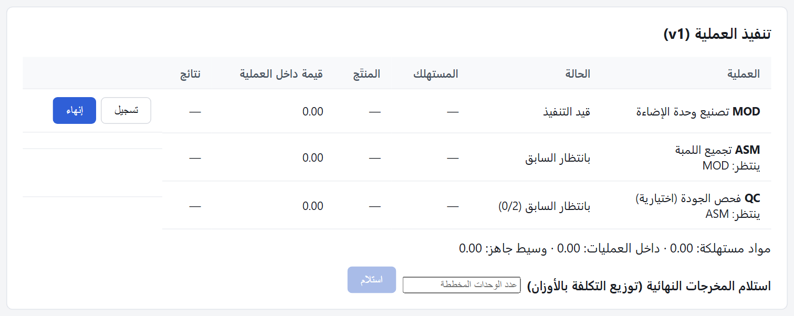
2. استهلاك WT-LED × 40 (يقيّم بـ 80.00 = 40 × 2.00) ← 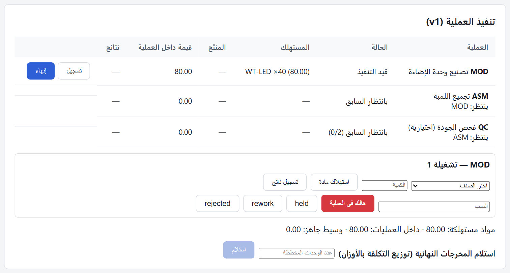
3. تسجيل ناتج WT-MODULE × 10 ← 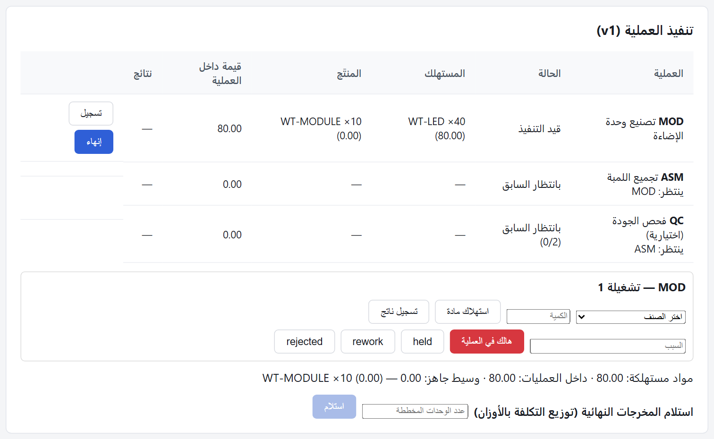
4. إنهاء MOD: الوحدات الوسيطة تحمل **80.00**، والقيمة داخل المرحلة تعود 0 ← 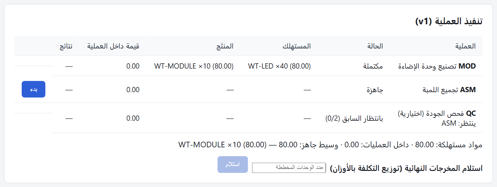
5. ASM أصبحت «جاهزة» وبدأناها ← 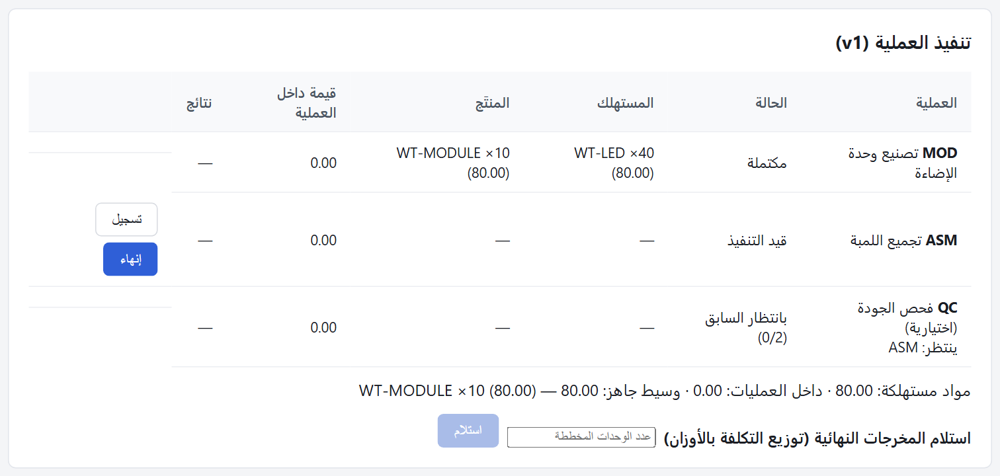
6. استهلاك الوحدة × 10 (80.00) والغلاف × 10 (50.00) ← 
7. **هالك في العملية:** كمية 1، السبب «كسر أثناء التجميع» ← 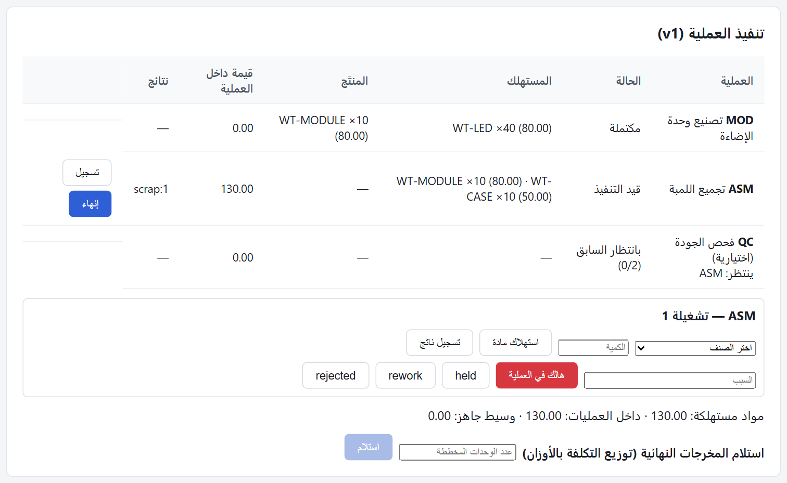
8. تسجيل ناتج WT-LAMP × 9 ثم إنهاء ASM ← 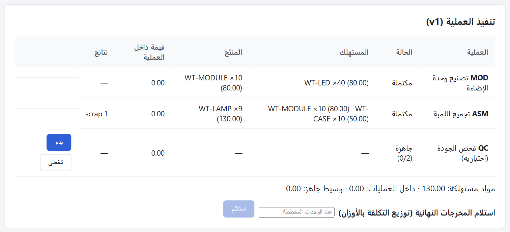
9. QC (اختيارية): بدء ثم إنهاء بلا نتائج ← 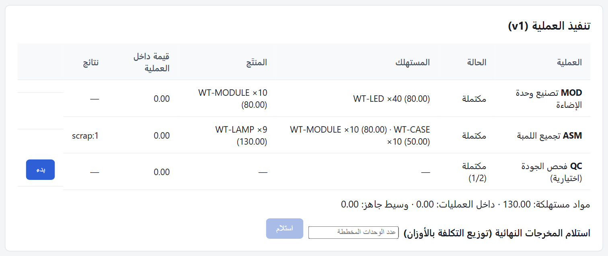
10. **استلام المخرجات النهائية:** 9 وحدات مخططة ← 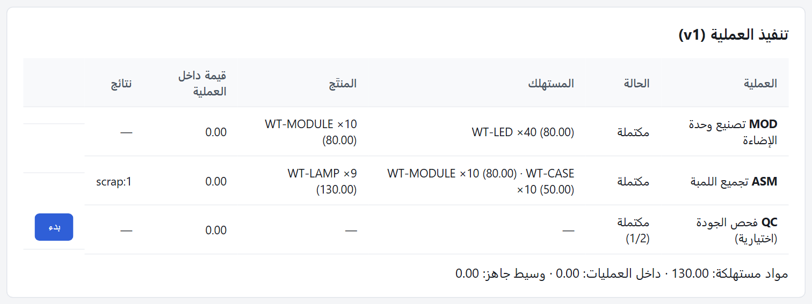
11. **إكمال** الأمر (الحالة: مكتمل، WIP 0.0000) ← [الصفحة الكاملة أعلاه](screenshots/30-order-completed-full.png)

**ما يمنع الانتقال:** مرحلة سابقة غير مكتملة («ينتظر: MOD») · استهلاك أكبر من خطة المرحلة أو من المصروف فعليًا أو من الوسيط المنتَج فعلًا · تجاوز «أقصى مرات» · عدم وجود سبب للهالك (3 أحرف على الأقل).

**شروط الإقفال (إكمال):** (1) لا مرحلة إلزامية غير منفَّذة ولا مرحلة «قيد التنفيذ»، (2) **رصيد WIP = صفر** (تفاوت ≤ 0.01)، (3) لا وحدات معلّقة/مرفوضة/إعادة تشغيل دون حسم. عند الإقفال تُفرَج الحجوزات المتبقية.

### 5.5 الحدث المالي المرفوض (حدث حقيقي في التجربة)
بعد تسجيل الهالك ظهر في بطاقة «الأحداث المالية» حدث **«مرفوض»** بسبب: *scrap-loss account is unset*. السبب: إعداد 5299 كان قد **أُرشف** (ت-م-01). الإصلاح عبر الواجهة فقط:
1. `/accounting/policy` ← إعادة اختيار 5299 ← «حفظ» ←  
2. `/accounting/financial-events` ← تصفية «مرفوض» ← «إعادة معالجة» للحدث ← 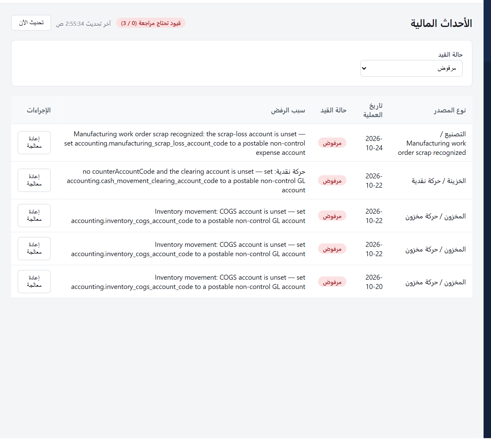 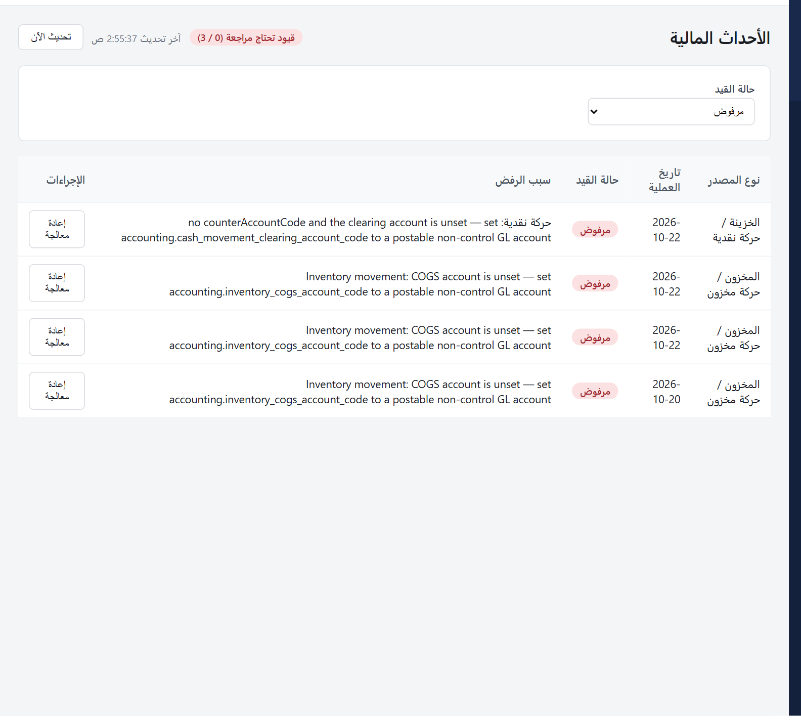

(الأحداث الأربعة الباقية في القائمة تخص فرقًا أخرى ولم تُمَس.) بعد إعادة المعالجة صار القيد **JV-2026-000017: مدين 5299 = 13.00 / دائن 1150 = 13.00**.

### 5.6 التجميع السريع — `/manufacturing/assembly`
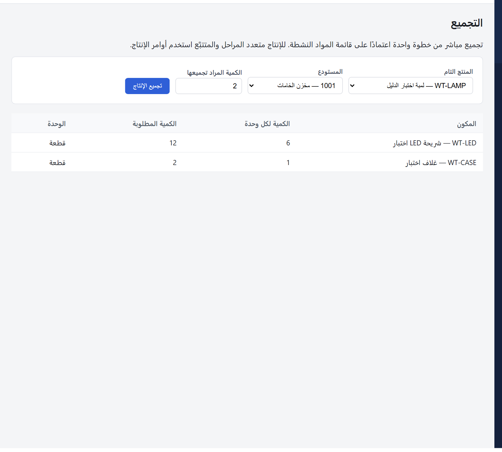 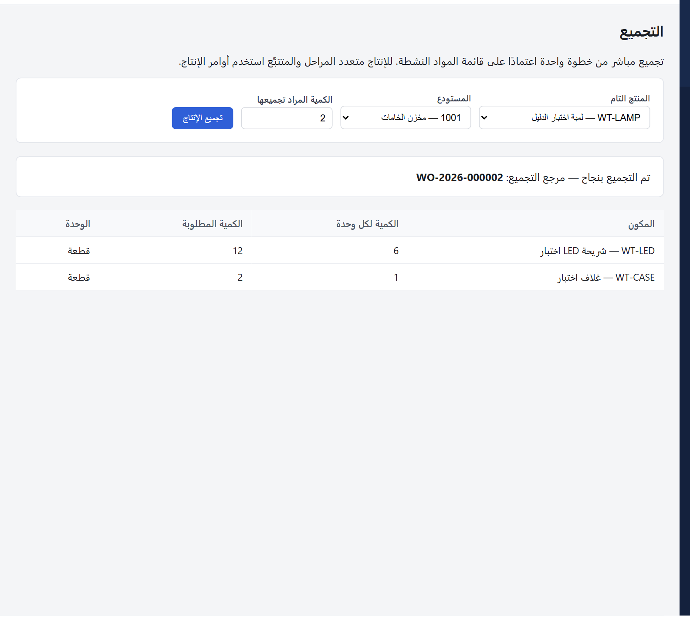

اختر المنتج (بوصفة BOM نشطة) والمستودع والكمية ← «تجميع الإنتاج». يعرض مرجعًا **WO-2026-000002** لأن النظام ينشئ **أمر إنتاج حقيقيًا** ويصدره ويصرف كل المكونات ويستلم المنتج ويقفله **في معاملة واحدة** (فشل أي جزء يلغي الكل). جرّبناه على الـBOM لـ 2 لمبة: صرف 12 شريحة + 2 غلاف (تكلفة 34.00)، استلام 2 لمبة (17.00 للوحدة).

---

## 6. نتائج السيناريو وآثارها (تحقق من قاعدة البيانات)

التحقق تم بقراءة مباشرة من قاعدة البيانات (`company_f3ea8a2e…`) لا من الواجهة.

### 6.1 الخطوات المبرمجة ← الأثر
| الخطوة | الشاشة | حركة مخزون | تكلفة | قيد محاسبي |
|---|---|---|---|---|
| إنشاء المنتجات | المنتجات | — | — | — |
| إعداد 5299 والسبب | السياسات | — | — | — |
| استلام 200 LED @2 + 100 غلاف @5 | مركز الحركات | +200 / +100 في 1001 | متوسط 2.00 / 5.00 | JV-12: م1120 400 / د3101 400 · JV-13: م1120 500 / د3101 500 |
| وصفة + وحدة + تعريف عملية | BOM / عمليات | — | — | — |
| إنشاء + إصدار أمر 10 لمبات | أوامر الإنتاج | حجز 40 + 10 | — | — |
| صرف 40 LED + 10 غلاف | تفاصيل الأمر | −40/−10 من 1001 و+40/+10 في WIP | نقل 80 + 50 إلى الوعاء | JV-14: م1150 80 / د1120 80 · JV-15: م1150 50 / د1120 50 |
| تشغيل MOD و ASM و QC | لوحة العملية | **لا شيء** (حساب مشتق فقط) | قيم المراحل | — |
| هالك 1 | لوحة العملية | −4 LED، −1 غلاف من WIP (10% من كل خامة) | 13.00 | JV-17: م5299 13 / د1150 13 |
| استلام 9 | لوحة العملية | +9 لمبة في 1001، −36 LED، −9 غلاف من WIP | 117.00 ÷ 9 = **13.00** | JV-16: م1120 117 / د1150 117 |
| إكمال | تفاصيل الأمر | — | WIP = 0 | — |

### 6.2 الأرصدة قبل وبعد (بالقطع)
| الصنف | قبل الأمر | صُرف | هالك | منتَج | بعد (مخزن 1001) | WIP بعد |
|---|---|---|---|---|---|---|
| WT-LED | 200 | 40 | 4 | — | **160** | 0 |
| WT-CASE | 100 | 10 | 1 | — | **90** | 0 |
| WT-MODULE (وسيط) | — | — | — | 10 داخل الأمر وأُستهلك | **0 (لا يدخل المخزن)** | — |
| WT-LAMP | 0 | — | 1 | 9 | **9 @13.00 = 117.00** | 0 |

(بعد التجميع السريع: LED 148، غلاف 88، لمبة 11 بقيمة 151.00 = 117 + 34.)

### 6.3 كيف حُسبت التكلفة
1. قيمة الوعاء بعد الصرف = 40×2.00 + 10×5.00 = **130.00**.
2. تكلفة الوحدة المخططة = 130.00 ÷ 10 = **13.00**.
3. الهالك (1 وحدة) أخذ **13.00** (يُحمَّل على 5299)؛ المتبقي 117.00.
4. استلام 9 وحدات يأخذ **كل** المتبقي (117.00) = 13.00 للوحدة.
5. الناتج: **WIP = 0.00 في الدفاتر والتقييم**، صافي القيود: م1120 887 · 1150 = 0 · د3101 900 · م5299 13 (ضمن كل ما أنشأته التجربة).

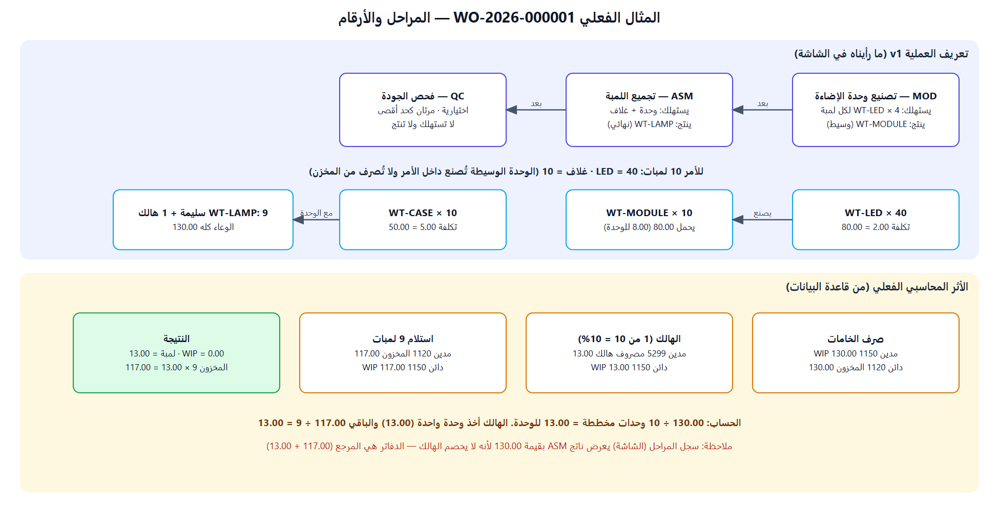

**سبب السماح بالإقفال:** كل المراحل الإلزامية مكتملة، لا تشغيل جارٍ، لا وحدات معلّقة، ورصيد WIP = 0.0000. **سيمنعه** وجود 0.01 أو أكثر في WIP أو وحدة معلّقة.

**ما لا تطابقه الواجهة:** جدول المراحل يُظهر ناتج ASM (WT-LAMP × 9) بقيمة **130.00** لأنه لا يخصم الهالك، بينما الدفاتر 117.00 + 13.00. الدفاتر هي المرجع (ت-و-03).

---

## 7. الفرق بين الشاشات والمسارات المتشابهة

| المقارنة | الفرق العملي |
|---|---|
| **BOM** مقابل **تعريف العملية** | BOM = «ماذا نحتاج» (قائمة) بلا ترتيب ولا وسيط. العملية = «كيف نصنع» (مراحل + ترتيب + مدخلات/مخرجات لكل مرحلة + إصدارات). |
| **تعريف العملية** مقابل **أمر الإنتاج** | الأول قالب ثابت لا يحرّك شيئًا. الثاني تنفيذ لكمية معينة يحرّك المخزون والتكلفة والقيود. |
| **تفاصيل الأمر** مقابل **تشغيل المرحلة** | التفاصيل = المستوى المالي والمخزني للأمر كله (إصدار/صرف/استلام/إقفال). التشغيل = تتبع ما حدث داخل كل مرحلة (لا يحرّك مخزونًا بنفسه). |
| **مسار التشغيل (Routings)** مقابل **تعريف العملية** | Routings قديم: ترتيب مراحل ومراكز عمل فقط بلا مواد (للمسار الأساسي). تعريف العملية يحل محله للمسار العام. |
| **متعدد المراحل** مقابل **التجميع السريع** | الأول ينفّذ الخطوات واحدة واحدة ويتيح الهالك والمراحل. الثاني ضغطة واحدة على BOM بلا مراحل (لكنه ينتج أمرًا كاملًا بالأثر نفسه). |
| `POST /manufacturing/quick-assembly` مقابل `POST /inventory/assemble` | الأول (الذي تستخدمه الشاشة الآن) ينشئ أمر إنتاج. الثاني **قديم** لا ينشئ أمرًا؛ مبقى مؤقتًا لمستهلكين قدامى واختبارات. **تقاعده قرار مؤجل بعد الـConsolidation** (وحدتا الاختبار t01-t02-oversell وinventory-valuation تُنقلان أولًا). |
| مسارا الاستلام داخل أمر عام | «استلام منتج تام» (أساسي) و«استلام المخرجات النهائية» (عام). الأول لا يعرف الناتج المشترك/الثانوي ولا الأوزان — استخدم الثاني لأوامر العمليات. |

---

## 8. الأخطاء الشائعة وعلاجها

| الرسالة / الموقف | السبب | العلاج |
|---|---|---|
| لا يوجد رمز سبب في الاستلام | لم يُعرَّف سبب | أضف السبب في `/accounting/policy` (أسباب الاستلام اليدوي) |
| «scrap-loss account is unset» (حدث مرفوض) | حساب هالك التصنيع غير معرَّف أو أُرشف | عيّنه في السياسات ثم «إعادة معالجة» من الأحداث المالية |
| `…has no ACTIVE process version` | لا إصدار نشط | فعّل مسودة في «تعريفات العمليات» |
| `Choose one alternative for …` | مجموعة بدائل بلا اختيار | اختر بديلًا لكل مجموعة في بطاقة الإنشاء |
| `Operation X cannot start - waiting for: …` | مرحلة سابقة لم تكتمل | أنهِ المراحل المذكورة |
| `operations run only while the order is in progress` | لم تُصرف خامة بعد | اصرف المواد أولًا |
| `Cannot consume N - plans M / only K has been issued` | تجاوز الخطة أو المصروف | قلّل الكمية أو اصرف مزيدًا |
| `Cannot complete … process operation(s) not done` | مرحلة إلزامية/جارية | أنهِها أو تخطَّ الاختيارية |
| `Cannot complete … WIP balance is …` | بقاء قيمة في الوعاء | استلم المخرجات أو أرجع الخامات |
| `still tracked as rework / rejected / held` | وحدات معلّقة | احسمها (جيد/هالك/إعادة) |
| `…is not a whole number of base units` | تحويل وحدات غير صحيح | استخدم وحدة أساسية أصغر |
| `Cannot scrap N — only M remaining` | الهالك فوق المتبقي من الخطة | قلّل الكمية |
| «إنشاء» لا يعمل / رمز مكرر | SKU مكرر | غيّر الرمز |

---

## 9. الوظائف: مدعوم / جزئي / غير متاح

| الوظيفة | الحالة | الدليل |
|---|---|---|
| إنشاء منتج، وحدات وتحويلات، BOM بكسور | **مدعوم** (جُرِّب) | §3–4 |
| تعريف عملية: مراحل، ترتيب، وسيط، اختيارية، تكرار، إصدارات | **مدعوم** (جُرِّب) | §5.1 |
| فروع متوازية + دمج + انتظار | **مدعوم** (اختبارات آلية + سابقة حية) | spec S4 |
| إنشاء/إصدار/صرف/إقفال أمر عمليات | **مدعوم** (جُرِّب) | §5.2–5.4 |
| هالك على مستوى المرحلة + القيد | **مدعوم** (جُرِّب) | §5.4–5.5 |
| إعادة معالجة الحدث المرفوض | **مدعوم** (جُرِّب) | §5.5 |
| التجميع السريع بأمر كامل | **مدعوم** (جُرِّب) | §5.6 |
| بدائل (Alternates) | **مدعوم بالكود والاختبار، غير مُجرَّب بصريًا** | اختبارات S3/S4 |
| ناتج مشترك/ثانوي وتوزيع بالأوزان | **مدعوم بالاختبار، غير مُجرَّب بصريًا** (جُرِّب بمخرج واحد) | حالة C3 |
| استرداد خامة من الهالك · معلّق/مرفوض/إعادة تشغيل | **مدعوم بالاختبار، غير مُجرَّب بصريًا** | S1 |
| الوحدات في محرر العملية | **جزئي**: الكميات صحيحة فقط، بلا اختيار وحدة (على عكس BOM) |
| BOM متعدد المستويات / بإصدارات / ببدائل | **غير متاح** (يُستعاض عنه بتعريف العملية) | |
| تكلفة المراحل (أجور/تشغيل/معيارية/انحرافات) | **غير متاح بقرار معتمد** | ADR-060 D2/D3 |
| اختيار مخزن للمنتج التام غير مخزن الأمر | **غير متاح** | ت-و-02 |
| تعديل اختيارات البدائل بعد إنشاء الأمر | **غير متاح** | |
| جدولة/طاقة/زمن المراحل · طباعة أوامر · تقارير تصنيع مخصصة | **غير متاح** | |

---

## 10. مشكلات التجربة المقترحة للتحسين لاحقًا (بلا تنفيذ الآن)

التصنيف: **م** مشكلة توثيق · **ت** تجربة استخدام · **و** نقص وظيفي · **ف** عطل/خطر تقني.

| الرمز | الفئة | الموقف | الأثر | الاتجاه المقترح |
|---|---|---|---|---|
| ت-م-01 | **ف** | قيمة إعداد حساب الهالك **أُرشفت** (`archivedAt` = 22:53 UTC) في اللحظة نفسها التي أُعيد فيها تشغيل خلفية من نسخة أقدم تخص جلسة أخرى على قاعدة التطوير المشتركة. الكود يفسّر ذلك: بذرة تسجيل المفاتيح تحذف أي مفتاح غير موجود في نسختها وتؤرشف قيمته (الاستنتاج أن تلك النسخة هي الفاعلة ترجيحي لا مؤكَّد). ظهر الأثر كحدث هالك مرفوض | تعطّل الهالك محاسبيًا بصمت إلى أن تُراجع الأحداث | عدم تشغيل نسختين مختلفتين على قاعدة مشتركة؛ وتحويل «الحذف التلقائي» إلى تحذير فقط |
| ت-م-02 | **ت** | الإعدادات المطلوبة للتصنيع (حساب الهالك، أسباب الاستلام) في صفحة طويلة من 18 إعدادًا بلا بحث أو قائمة «تهيئة التصنيع» | يصعب معرفة المطلوب | قائمة تحقق للتجهيز |
| ت-م-03 | **ت** | نموذج الاستلام اليدوي لا يوجّه المستخدم إلى مكان تعريف الأسباب إذا كانت القائمة فارغة | حيرة | رابط/تلميح |
| ت-م-04 | **ت/و** | الوحدة نص حر في المنتج («قطعة» ≠ «قطعه») | وحدات أساسية متعددة للمنتج نفسه | قائمة وحدات |
| ت-م-05 | **ت** | وصفة BOM تُعرض/تُعاد فتحها بالوحدة الأساسية (6) لا بما كُتب (0.5 دستة) | فقد ما أدخله المستخدم | حفظ الوحدة المُدخلة |
| ت-م-06 | **ت** | المنتج يُنشأ بحالة «مسودة» دون شرح لمعناها (يوجد زر «تفعيل» في قائمة المنتجات)، ومع ذلك يعمل في كل شيء | غموض معنى الحالة | شرح أو إزالة الحالة |
| ت-ت-01 | **ت** | حفظ مسودة العملية لا يعطي رسالة نجاح؛ زر «حفظ وتفعيل» لا يظهر إلا بعد أول حفظ | خطوتان مخفيتان | رسالة + إظهار الزر دائمًا |
| ت-ت-02 | **ت** | محرر العملية: أعمدة المواد/المخرجات بلا عناوين، «الوزن» و«وسيط» بلا شرح، و«تشغيل / تحويل» قريبة الاسم من «إعادة تشغيل» في قائمة النوع | أخطاء إدخال | عناوين أعمدة وتلميحات |
| ت-ت-03 | **ت** | تسمية متقاربة: «مسارات التشغيل» (Routings) و«تعريفات العمليات» في القائمة نفسها | التباس | توضيح أن الأولى للمسار الأساسي |
| ت-ت-04 | **ت** | لوحة «تنفيذ العملية» تظهر بالفعل على أمر **مسودة** ولا تنفع فيه | التباس | إخفاؤها قبل الصرف |
| ت-ت-05 | **ت** | أزرار نتائج المرحلة بالإنجليزية (rejected / rework / held) | عدم اتساق لغوي | ترجمة |
| ت-ت-06 | **ت** | قائمة اختيار الصنف في نماذج تسجيل التشغيل تخلط «مادة» و«ناتج» معًا، ولا تظهر كمية الخطة إلا بين قوسين داخل الاسم | بطء/خطأ | فصل القائمتين وعرض المخطط |
| ت-ت-07 | **ت** | قائمة الأوامر لا تميّز الأمر العام عن الأساسي، وعمود «الكمية المتبقية» يعرض 1 لأمر مكتمل (يتجاهل الهالك) | تضليل | عمود نوع + احتساب الهالك |
| ت-و-01 | **و** | أمر العمليات يعرض مسار «استلام منتج تام» الأساسي بجانب «استلام المخرجات» العام | خطر استعمال المسار الخطأ (يتجاهل الأوزان) | إخفاء الأساسي لأوامر العمليات |
| ت-و-02 | **و** | المنتج التام يُستلم دائمًا في مخزن الأمر (هنا مخزن الخامات 1001) | لا فصل بين مخزن الخامات والتام | اختيار مخزن المنتج التام |
| ت-و-03 | **و/ف** | سجل المراحل (المشتق) لا يخصم الهالك: ناتج ASM = 130.00 والدفاتر 117.00 | تضارب بين الشاشة والدفاتر | تعديل الحساب المشتق |
| ت-و-04 | **و** | الهالك يُسجَّل حتى لو كان حساب الهالك غير معرّف؛ يُرفض القيد لاحقًا فقط (الحركة المخزنية تتم) فيحدث فرق مؤقت بين التقييم والدفاتر (WIP 13.00) إلى أن يُعاد المعالجة | انحراف بين المخزون والدفاتر | منع الهالك مسبقًا أو تنبيه فوري |
| ت-و-05 | **و** | الحدث المرفوض يظهر في بطاقة الأمر لكن إعادة المعالجة في شاشة أخرى بلا رابط | مسار شفاء مخفي | زر/رابط من بطاقة الأمر |
| ت-و-06 | **و** | محرر العملية بلا اختيار وحدات (الكميات أرقام صحيحة فقط) | عدم اتساق مع BOM | إضافة الوحدة |

---

## 11. التحقق التقني الداعم
- اختبارات قاعدة بيانات حقيقية (معزولة): S1 10/10 · S2 7/7 · S3 9/9 · S4 11/11 · الحالات 6/6 · S6 3/3 · سياسة المحاسبة 8/8؛ اختبارات الوحدة 523/523.
- ملفات الاختبار: `backend/tools/testing/regression-specs-mfg-engine.txt` (قائمة جاهزة للتشغيل).
- الوثائق ذات الصلة: `MANUFACTURING_ENGINE_DECISIONS_2026_10_24.md` · `MANUFACTURING_ENGINE_COMPLETION_REPORT_2026_10_24.md`.

---

## 12. سجل بيانات التجربة (للتنظيف الآمن لاحقًا)

> **لم تُحذف.** التنظيف يتم بالمعرّفات أدناه فقط (الأسلوب نفسه الذي نُفِّذ سابقًا: معاينة بلا تطبيق ثم تنفيذ في معاملة). **لا تحذف بالاسم.** بيانات الفرق الأخرى في Alpha (منتج PRD-200001، 25+ منتجًا قائمًا، أحداث COGS/نقدية المرفوضة) **ليست** من هذه التجربة.

| النوع | المعرّف |
|---|---|
| المنتجات | WT-LAMP `f0755631-4b9a-4b69-8755-0e01b24ec65a` · WT-LED `e576a105-fedc-4092-8cd2-0bc49c61f0c9` · WT-CASE `cf41729d-4e5e-4c5f-b608-44da56b415ce` · WT-MODULE `fc182ec0-cd06-4c6b-b9a5-02b24835d831` |
| مستند الاستلام | WH-IN-2026-000001 `30499750-13c0-4d55-9c8b-6acb7936157f` |
| BOM | `546244c1-93aa-429a-8eb9-dfa9621668d7` (WT-LAMP) |
| تحويل الوحدة | `f3fe27a5-ace0-47c7-aa9c-0b7f3d534ea4` (WT-LED دستة = 12) |
| إصدار العملية v1 | `1bc044e1-e8a4-41f9-aaf2-db3fa8dc6fb1` |
| الأمر 1 (عمليات) | WO-2026-000001 `b33728e0-b0a8-4b5c-bb0d-30f3a808f721` · مخزن WIP `1da0d740-fff0-453f-9006-79a9759332f8` |
| الأمر 2 (تجميع سريع) | WO-2026-000002 `87dceaf1-a157-45af-8506-10317f85ffc1` · مخزن WIP `56d526e4-472d-4bcd-bed5-8cc2b63801da` |
| تشغيلات المراحل | MOD `b5af5626-1618-4446-9f03-43d1a0a226d7` · ASM `d451ce88-8f43-4807-bb2d-0adb8fa35160` · QC `47a9cd9b-f063-4536-8761-727892047ede` |
| نتائج الإنتاج | هالك `226cabf7-6773-48a0-8981-f967fc6fb18c` · مقبول `736131af-88b5-4ca1-95d0-2e63643ca08e` |
| القيود | JV-2026-000012 … JV-2026-000020 (استلام ×2، صرف ×2، استلام منتج، هالك، ثم أحداث الأمر 2) |
| إعدادات `daii_dev` (تُزال عند التنظيف إن لم تلزم) | حساب الهالك 5299 (`a3fd014e-31ef-49fa-a61a-7cc3fa84b5bc`، سبقه صف مؤرشف `c1ac3463-…`) · أسباب الاستلام `{wt_initial_stock: 3101}` (`b877894a-7ce5-4e0b-8431-75b07b670063`) |
| عدادات الترقيم | JV بعد 11 ، WO بعد 0 قبل التجربة (تُعاد عند التنظيف) |

