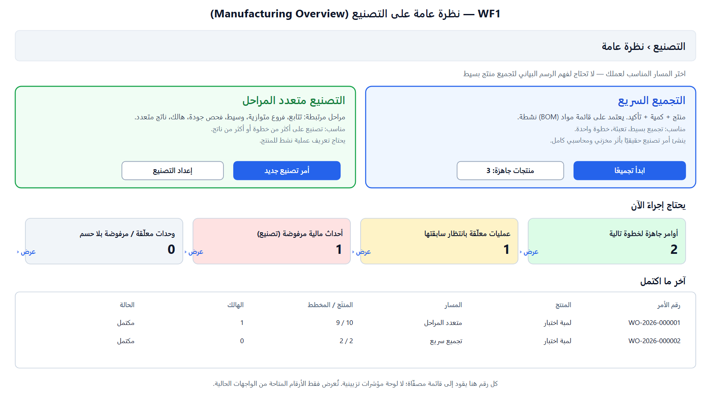
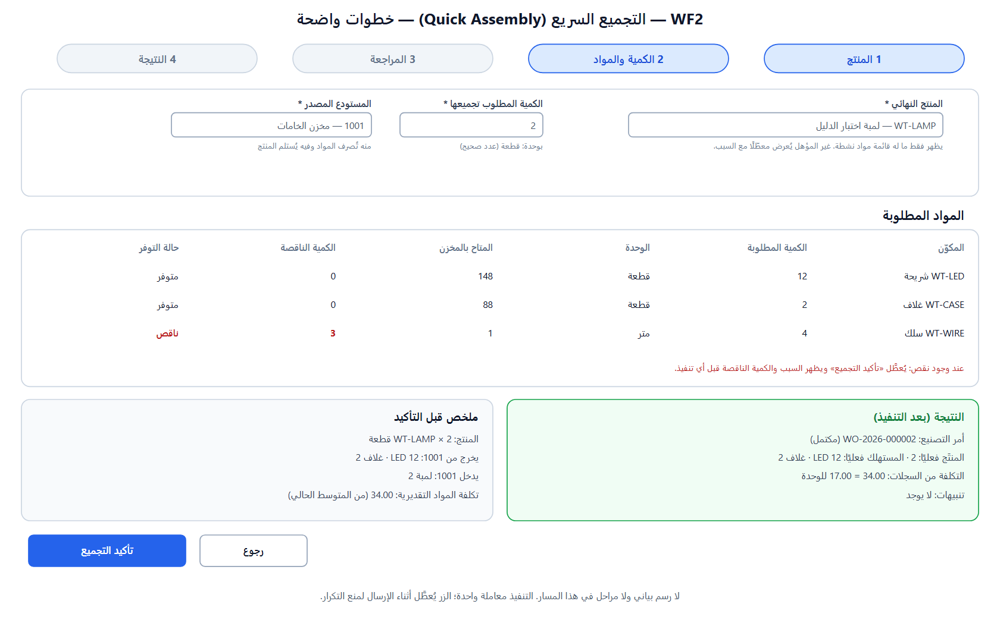
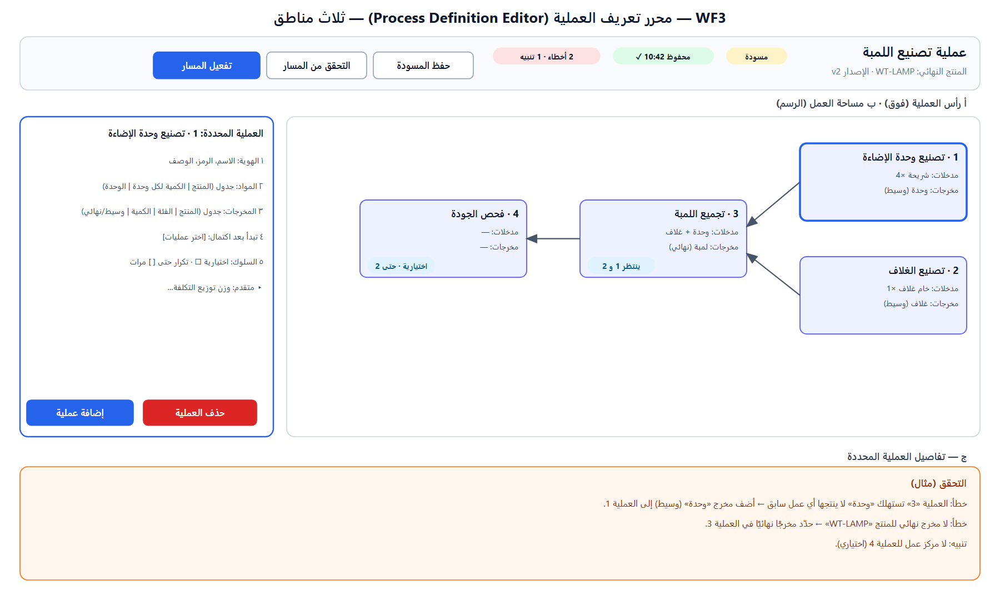
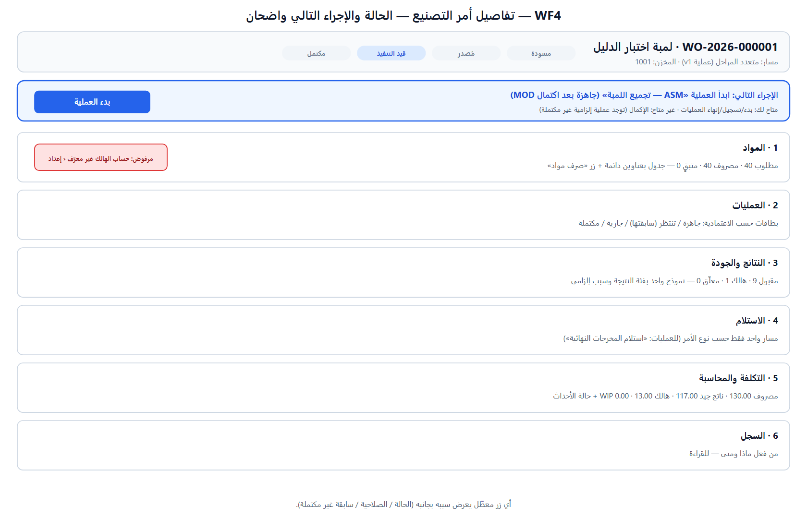
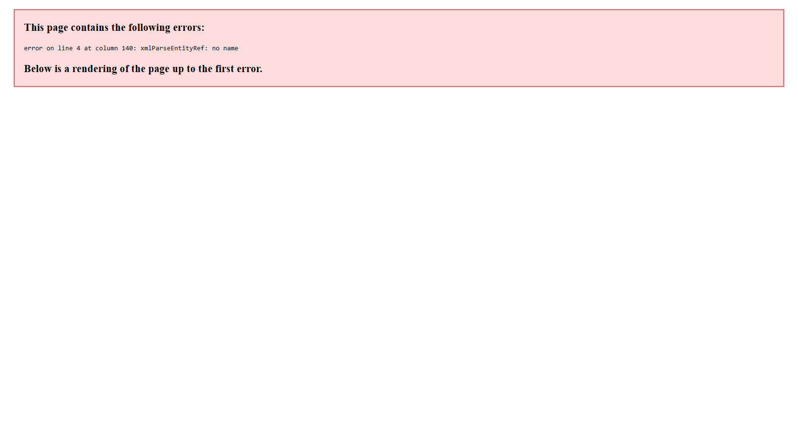

<div dir="rtl">

# إعادة تصميم تجربة محرك التصنيع — المرحلة 1: مراجعة الوضع الحالي وهندسة التجربة

**المرجع:** CTO MASTER DIRECTIVE — Manufacturing Engine Final UX/UI Redesign · **الفرع:** `feature/manufacturing-engine-design`
**الحالة:** **للمراجعة — لم يُنفَّذ أي تعديل كود.** وفق التكليف («لا إعادة كتابة قبل مراجعة الربط») ومالاحظتك الأخيرة (مراجعة الهيكل أولًا ثم مراحل). لا دمج ولا إصدار ولا نشر.
**ما في هذه الدفعة:** (أ) جرد الشاشات والواجهات والصلاحيات والحالات، (ب) تتبع الأسباب الجذرية لـ T-M-01 وT-W-03 وT-W-04 بأدلة، (ج) تصنيف كل مشكلة (واجهة فقط / خلفية / قرار)، (د) هيكل التنقل الجديد وتصميمات الشاشات (5 wireframes)، (هـ) قاموس العناوين والحالات ورسائل التحقق، (و) خطة المراحل 2–6 وقرارات مطلوبة منك.

---

## 1. الخلاصة التنفيذية

1. **12 من 19 مشكلة موثّقة واجهة فقط** (بينها T-T-03 التي تحتاج إضافة صغيرة في سجل التنقل) ويمكن حلها دون المساس بقواعد المخزون أو التكلفة أو المحاسبة.
2. **ثلاث مشكلات حقيقية في الخلفية** لا تُحل بالتصميم: **T-W-03** (فرق قيمة سجل المراحل 130 مقابل 117)، **T-W-04** (الهالك يمرّ بلا حساب هالك)، **T-W-01** (مساران للاستلام على أمر العمليات). أسبابها الجذرية محددة أدناه مع تصميم الإصلاح والاختبار.
3. **T-M-01 ليست عطلًا في التصنيع**؛ هي سلوك مؤسسي مدمّر في «مزامنة سجل الإعدادات» عند إقلاع نسخة أقدم. **أثبتّها بالأدلة** (§5-أ) وهي **تضرب فرقًا أخرى أيضًا** (مفاتيح الشراء)، وتكررت **اليوم 10:27 UTC** فأُرشف حساب الهالك مجددًا. الإصلاح الحقيقي قرار مؤسسي منفصل (§9-D4).
4. **عنصران يحتاجان قرارًا قبل أي تنفيذ** لأنهما تغيير نموذج بيانات: **T-W-02** (مخزن للمنتج التام) و**T-M-05/T-M-04** (حفظ الوحدة المُدخلة وكتالوج وحدات). أعرض لهما بديلًا آمنًا ضمن العقد الحالي وأتوقف عند الباقي.
5. **تصحيح لدليلي السابق:** شاشة المنتجات **فيها** زر «تفعيل» لكل منتج مسودة (لم أذكره). الصحيح: المشكلة T-M-06 أن معنى «مسودة» غير مشروح، لا أن التفعيل مفقود. (صُحِّح في الدليل.)
6. **دين تقني اعترفت به:** الشاشات الخمس التي بنيتها في S1–S5 (Processes وProcessExecutionPanel وWorkOrderOutcomes وNewProcessOrder وProductUnits) تستخدم **نصوصًا مضمَّنة بالعربية/الإنجليزية** بدل نظام المصطلحات المعتمد في المنصة (`t('…')`)، ولا يوجد فيها `htmlFor`/`aria`. سيُعالج ضمن إعادة البناء (§7).

---

## 2. جرد الوضع الحالي (مبني على الكود والتجربة)

### 2.1 الشاشات والمسارات والواجهات والصلاحيات

| الشاشة | المسار | المكوّن (سطر) | الواجهات المستخدمة (API) | الصلاحيات | i18n | ملاحظات |
|---|---|---|---|---|---|---|
| غرفة القيادة | `/manufacturing` | `ManufacturingCover` (109) | `GET boms, routings, work-centers, work-orders` | `manufacturing.*` view | `t()` | أرقام فقط بلا مسار ولا إجراءات |
| أوامر الإنتاج (قائمة + إنشاء مزدوج) | `/manufacturing/work-orders` | `WorkOrders` (234) + `NewProcessOrder` (125) | `GET/POST work-orders`, `POST process-orders`, `GET processes` | `work_order.view/create` | مختلط | نموذجان في صفحة واحدة؛ المتبقي = المخطط − المنتج |
| تفاصيل الأمر | `/manufacturing/work-orders/:id` | `WorkOrderDetail` (544) | `GET work-orders/:id` + إجراءات | `release/material_issue/material_return/finished_goods_receive/complete/cancel/hold` | `t()` | بلا قسم «الإجراء التالي»؛ مساران استلام |
| لوحة تنفيذ العملية | داخل التفاصيل | `ProcessExecutionPanel` (208) | `GET process-orders/:id`, start/skip/consume/yield/complete/scrap/outcome/output | `work_order.operation_execute` / `outcome_record` / `finished_goods_receive` | **مضمَّن** | تظهر على أمر مسودة |
| نتائج الإنتاج | داخل التفاصيل | `WorkOrderOutcomes` (231) | `POST scrap/recovery/outcomes` | `outcome_record` | **مضمَّن** | |
| قوائم المواد + الوحدات | `/manufacturing/boms` | `ManufacturingBoms` (373) + `ProductUnits` (126) | `GET/POST boms`, `unit-conversions` | `bom.*` | مختلط | الوصفة تُعاد بالوحدة الأساسية |
| تعريفات العمليات | `/manufacturing/processes` | `Processes` (428) | `GET/POST processes…` | `routing.*` (مُعاد استخدامها) | **مضمَّن** | محرر جداول لا رسم |
| التجميع | `/manufacturing/assembly` | `Assembly` (175) | `GET boms`, `POST quick-assembly` | `inventory.assembly.create` | `t()` | نموذج من 3 حقول؛ بلا مراجعة مواد ولا توفر |
| مسارات التشغيل / مراكز العمل | `/manufacturing/routings` · `/work-centers` | `Routings` (353) · `WorkCenters` (190) | CRUD | `routing.*` · `work_center.*` | `t()` | المسار الأساسي القديم |
| السياسات المحاسبية | `/accounting/policy` | (خارج التصنيع) | `GET/POST policy-config` | `accounting.account.view/edit` | `t()` | 18 إعدادًا في صفحة واحدة |
| الأحداث المالية | `/accounting/financial-events` | (خارج التصنيع) | `GET events`, `POST redrive` | `accounting.financial_event.view` / `accounting.journal.post` | `t()` | |
| المنتجات | `/products` | (خارج التصنيع) | `POST/GET products` | `sales.catalog.create/edit` | `t()` | زر «تفعيل» موجود لكل مسودة |

**الواجهة/التصميم الحالي:** فئات عامة (`card`, `btn`, `form-field`, `data-table`, `error-text`, `empty-state`) و`StatusBadge`؛ `index.css` 19 سطرًا و`App.css` 184 سطرًا بلا رموز تصميم (tokens)؛ نقاط كسر عند 1024px فقط. **لا `aria-*` ولا `htmlFor` ولا `role` في أي ملف تصنيع (0 من 12).**

### 2.2 حالات أمر التصنيع وما تعرضه الواجهة (الحالة → الإجراء)

```
مسودة ──إصدار──▶ مُصدر ──(أول صرف مواد)──▶ قيد التنفيذ ◀──استئناف── معلّق
  │                │                         │  └──إيقاف مؤقت──▶ معلّق
  └──إلغاء──▶ ملغى ◀──إلغاء (بلا صرف)         └──إكمال──▶ مكتمل
```
| الحالة | إجراءات يسمح بها الخلفية | ما يعرضه الـ UI اليوم | فجوة |
|---|---|---|---|
| مسودة | إصدار، إلغاء | لوحة العملية ظاهرة (غير صالحة) + نموذج هالك مغلق | T-T-04 |
| مُصدر | صرف مواد، إلغاء | صرف + (للعملية) لوحة غير صالحة | |
| قيد التنفيذ | صرف/إرجاع، تشغيل مراحل، هالك/تتبع، استلام، إيقاف، إكمال | الكل بلا إرشاد للتالي | لا «الإجراء التالي» |
| معلّق | استئناف، إرجاع مواد، تتبع | | |
| مكتمل/ملغى | قراءة فقط | | القائمة تعرض «متبقٍ 1» (T-T-07) |

---

## 3. سجل المشكلات والتصنيف والمرحلة والتصرف المقترح

التصنيف: **UI** واجهة فقط · **BE** عطل/نقص خلفية · **DEC** يتطلب قرارًا · **SCH** يتطلب تغيير نموذج بيانات.

| ID | المشكلة | التصنيف | الأساس (محقَّق) | المرحلة | التصرف المخطط |
|---|---|---|---|---|---|
| T-M-01 | قيمة حساب الهالك أُرشفت | **BE مؤسسي + DEC** | §5-أ | تشغيلية الآن / قرار D4 | تحذير في الواجهة عند اختفاء قيمة + قاعدة تشغيل «نسخة واحدة»؛ الإصلاح الجذري خارج التصنيع |
| T-M-02 | الإعدادات المحاسبية متفرقة | UI | صفحة 18 إعدادًا | 3 | قسم «تهيئة التصنيع» مع حالة كل إعداد + بحث + روابط |
| T-M-03 | الاستلام لا يرشد لسبب مفقود | UI | قائمة الأسباب فارغة بلا تلميح | 3 | رسالة بديلة + رابط الإعداد (حسب الصلاحية) |
| T-M-04 | وحدة المنتج نص حر | **DEC/SCH** | لا كتالوج وحدات في الكود | 3 (آمن) | اقتراحات من الوحدات المستخدمة + تحذير أسماء متقاربة (قطعة/قطعه). الكتالوج الحقيقي ← D3 |
| T-M-05 | الـBOM تفقد الوحدة المُدخلة | **DEC/SCH** | تُخزَّن الكمية أساسية فقط | 3 (آمن) | عرض مكافئ محسوب «6 قطعة = 0.5 دستة» (قراءة). الحفظ الدائم ← D3 |
| T-M-06 | حالة «مسودة» غير مشروحة | UI | زر التفعيل موجود | 3 | شرح الحالة + شارة جاهزية |
| T-T-01 | حفظ المسودة بلا تأكيد | UI | `Processes.save` | 3 | شريط حالة حفظ صادق + تفعيل واضح |
| T-T-02 | أعمدة بلا عناوين | UI | `Processes.tsx` | 3 | عناوين دائمة + شرح وسيط/وزن |
| T-T-03 | Routings وتعريفات العمليات متجاورتان | UI + BE(nav registry) | `navigation-registry.ts` | 2 | تجميع/تسمية جديدة (D5) |
| T-T-04 | لوحة العملية على مسودة | UI | شرط `processVersionId` فقط | 4 | إخفاء/تعطيل مع السبب |
| T-T-05 | أزرار نتائج بالإنجليزية | UI | `ProcessExecutionPanel` | 4 | مصطلحات |
| T-T-06 | قائمة تخلط مواد ونواتج | UI | `ProcessExecutionPanel` | 4 | قسمان منفصلان + سياق الخطة |
| T-T-07 | القائمة لا تميّز النوع والمتبقي خاطئ | UI | سطر 216: `planned − produced` | 4 | عمود المسار + المتبقي يطرح الهالك |
| T-W-01 | مسارا استلام معًا | **BE + UI + DEC** | `finishedGoodsOutput` يقبل أوامر العمليات | 4 | D1 |
| T-W-02 | المنتج التام يدخل مخزن الأمر | **SCH + DEC** | `warehouseId` وحيد | مؤجل | D2 — لا تنفيذ في هذه الحزمة |
| T-W-03 | قيمة سجل المراحل ≠ الدفاتر | **BE** | §5-ب | 5 | إصلاح الحساب + اختبار مطابقة |
| T-W-04 | الهالك بلا حساب هالك | **BE + UI** | §5-ج | 5 | تحقق مسبق عبر سياسة المحاسبة |
| T-W-05 | الحدث المرفوض ويُعالَج في مكان آخر | UI | بلا رابط | 5 | رابط/زر حسب الصلاحية |
| T-W-06 | محرر العملية بلا وحدات | UI (ضمن العقد) | `GET …/convert` موجود | 3 | تحويل عند الإدخال، تخزين أساسي، توضيح الحد |

**مشكلات إضافية من التكليف (غير مرقّمة):** Quick Assembly بلا مراجعة مواد/توفر/نتيجة تفصيلية (UI + قراءة مخزون)، جاهزية المنتج للتصنيع (UI قراءة)، نصوص مضمَّنة وغياب `aria`/`htmlFor` (دين UI)، تعدد القوائم في صفحة واحدة.

---

## 4. تقدير حجم التغيير

| الفئة | العدد | ملاحظة |
|---|---|---|
| واجهة فقط (تشمل T-T-03 مع إضافة تنقل) | 12 | آمنة، بلا أثر على المخزون/التكلفة |
| خلفية (BE) | 4 (T-W-01، T-W-03، T-W-04، وT-M-01 مؤسسي) | تتطلب اختبارات قاعدة حقيقية وموافقتك على التصميم أدناه |
| قرار/نموذج بيانات | 3 (T-W-02، T-M-04، T-M-05 بشكلها الكامل) | أتوقف عندها وفق تعليماتك؛ يُعرض بديل آمن ضمن العقد الحالي حيث أمكن |

---

## 5. تتبع الأسباب الجذرية

### أ) T-M-01 — لماذا اختفى حساب الهالك (مُثبَت بالأدلة)

**الآلية (من الكود):** عند إقلاع أي نسخة خلفية، `config-registry.seeder.ts` يقارن مفاتيح الإعدادات المعروفة في **كودها** بما في القاعدة؛ كل مفتاح في القاعدة **غير موجود في كودها** يُحذف من `config_keys` وتُؤرشف قيمه (`archivedAt`). نسخة أحدث تعيد إضافة المفتاح لكن **لا تعيد القيمة المؤرشفة**.

**الدليل (سجل التدقيق `configuration.registry.synced` على `daii_dev`):**

| الوقت (UTC) | عدد المفاتيح | النتيجة | المفاتيح المحذوفة |
|---|---|---|---|
| 18:57 (24/10) | **64** | حذف | 4 مفاتيح تكلفة الشراء (فريق آخر) |
| 19:43 → 20:36 | 68 → 69 | إضافة | — |
| 20:37 | **64** | حذف | 4 مفاتيح شراء + حساب الهالك |
| 20:41 | 69 | إضافة 5 | — |
| 22:53 | **64** | حذف | الخمسة (وفيها حساب الهالك — أُرشف 22:53:09) |
| 23:50 | 69 | إضافة 5 | — |
| 10:27 (25/10) | **64** | حذف | الخمسة (**أُرشفت القيمة الثانية 10:27:05**) |
| 10:52 | 69 | إضافة 5 | — |

**الاستنتاج المثبت:** نسختان بخلفيتين مختلفتين (69 مفتاحًا = فرع المحرك، 64 = النسخة الرئيسية) تتناوبان الإقلاع على قاعدة التطوير المشتركة، وكل إقلاع 64 يمحو المفاتيح الخمسة. (لم نستطع تحديد *أي عملية بعينها* لكن *النسخة* مثبتة بعدد المفاتيح وتوقيت كل إقلاع.) **أثر على الآخرين:** مفاتيح الشراء الأربعة تُمحى معنا مرارًا (لا قيم محفوظة لها حاليًا في القاعدة فلم تُفقد بيانات).
**الوضع الحالي:** قيمة حساب الهالك **مؤرشفة** (منذ 10:27 اليوم). أي هالك الآن سيُرفض قيده حتى يُعاد ضبطها.
**الإصلاح:** (1) تشغيلي فوري: نسخة خلفية واحدة على القاعدة المشتركة. (2) جذري (مؤسسي، خارج هذه الحزمة، يؤثر على كل الفرق): جعل المزامنة **غير مدمّرة** (تعليم المفتاح «مُهمَل» بدل الحذف/الأرشفة). (3) داخل الحزمة: عرض تحذير في `/accounting/policy` وفي شاشة الهالك إذا وُجدت قيمة مؤرشفة للمفتاح. **لا أعدّل المزامنة دون قرارك (D4).**

### ب) T-W-03 — 130 مقابل 117

**ما يحدث:** `ProcessExecutionService.completeRun` يوزّع **قيمة ما استهلكته المرحلة** على مخرجاتها. ASM استهلكت 80 (وحدات) + 50 (غلاف) = 130 وأنتجت 9 لمبات ← قيّمها 130. أما **الهالك** (وحدة واحدة = 13.00) فيُسجَّل في `work_order_results` ويُرحَّل على مستوى الأمر؛ **سجل المراحل لا يطّلع عليه**. الدفاتر: 9 لمبات = 117 والهالك 13 ← مجموع 130 صحيح؛ العرض المشتق فقط خاطئ.
**السبب الجذري:** إسقاط (projection) لا يدخل فيه الهالك المنسوب لنفس المرحلة.
**تصميم الإصلاح (بلا تغيير مخطط قاعدة البيانات):** عند `completeRun` تُطرح من قيمة المخرجات **قيمة الهالك المسجَّل على نفس المرحلة أثناء تشغيلها** (`work_order_results` حيث `operationId` = المرحلة وصنف `scrap` و`createdAt ≥ startedAt`). الهالك لا يُقبل إلا والتشغيل جارٍ والتشغيل واحد لكل مرحلة في الوقت نفسه ← النسبة غير ملتبسة. تُقتطع عند صفر. تُضاف **كتلة مطابقة** في اللوحة: «مجموع السجل = رصيد WIP الدفتري + الناتج + الهالك» بالأرقام.
**اختبار القبول:** السيناريو المنفَّذ (130 مصروف، هالك 1، استلام 9) ← مخرج ASM = 117، ومجموع (المخرج + الهالك المنسوب) = 130 = الدفتر؛ سيناريو هالك في المرحلة الأولى ينقص قيمة الوسيط ثم ينتهي بنفس 117؛ سيناريو بلا هالك لا يتغير؛ اختبار قاعدة حقيقية A/B. **يحتاج موافقتك (D7).**

### ج) T-W-04 — الهالك مع حساب غير معرَّف

**ما يحدث:** `WorkOrderService.recordScrap` يستهلك المكونات ويكتب الحركة والتقييم ثم ينشر الحدث؛ **المعالج المحاسبي** وحده يكتشف غياب الحساب لاحقًا فيرفض الحدث. النتيجة: حركة تمت وقيد لم يُرحَّل (فرق WIP 13.00 كما رأينا).
**السبب الجذري:** لا فحص مسبق (pre-mutation gate) للهالك، خلافًا لنمط معتمد في المخزون (`assertManualReceiptReason`, `assertSaleReturnPostable`, `assertSupplierInvoicePostable` عبر `InventoryPostingPolicyRegistry` بدون استيراد دائري).
**تصميم الإصلاح:** إضافة بوابة اختيارية `assertManufacturingScrapPostable?()` في السياسة نفسها، يطبّقها المحاسبة (تتحقق أن حساب الهالك مضبوط وحساب مصروف نشط قابل للترحيل ولا يتحكم)، ويستدعيها `recordScrap`/`recordRecovery` **قبل أي كتابة** (409 برسالة تحدد الإعداد). في الواجهة: يُعطَّل «تسجيل الهالك» مع السبب ورابط الإعداد حسب الصلاحية. **لا يتغير** أي قيد أو سياسة. **اختبار:** هالك بلا إعداد ← 409 وبلا حركة ولا حدث ولا فرق؛ مع الإعداد ← يعمل كما اليوم. **يحتاج موافقتك (D6).**

---

## 6. هيكل المعلومات الجديد

### 6.1 الخريطة (القديم ← الجديد)


| المنطقة الجديدة | الشاشات | مصدرها اليوم |
|---|---|---|
| **أ. نظرة عامة** `/manufacturing` | مساران رئيسيان + «يحتاج إجراءً» + آخر ما اكتمل | `ManufacturingCover` (يُستبدل) |
| **ب. إعداد التصنيع** | جاهزية المنتجات (جديد، قراءة) · وحدات وتحويلات · قوائم المواد · تعريفات العمليات · *(قديم: مسارات التشغيل، مراكز العمل)* | `boms` + `ProductUnits` + `processes` + `routings` + `work-centers` |
| **ج. تنفيذ الإنتاج** | **التجميع السريع** `/manufacturing/assembly` (مع إبقاء الرابط) · **أوامر التصنيع متعدد المراحل** · تفاصيل الأمر (فيها تنفيذ العمليات) | `Assembly` + `work-orders` |
| **د. التكلفة والمراجعة** `/manufacturing/exceptions` (جديد) | مطابقة، استثناءات مرفوضة، روابط تدقيق | بيانات موجودة من الأحداث المالية وتفاصيل الأمر |

**آلية التنقل:** الشريط الجانبي «مدفوع من الخادم» (`/me/navigation` من `NAVIGATION_REGISTRY`)، العناصر مسطحة داخل المجموعة بلا أقسام فرعية. **الاقتراح (D5):** إضافة حقل **اختياري** `section` إلى `NavItem` يعرضه `Layout.tsx` كعناوين فرعية داخل مجموعة «التصنيع». إضافي ولا يغيّر صلاحيات ولا سلوك أي مجموعة أخرى. **البديل:** 4 مجموعات منفصلة (أثقل على الشريط). **الروابط القديمة كلها تبقى تعمل** (لا كسر للمفضلات).

### 6.2 مبدأ الفصل
**تعريف** (ب: ما الذي نصنعه وكيف) **≠ تنفيذ** (ج: ما يحدث في أمر معين) **≠ مراجعة** (د: ماذا كانت النتيجة المالية). لا شاشة تجمع اثنين.

---

## 7. تصميمات الشاشات (Wireframes)

### WF1 — نظرة عامة

**قرارات:** مساران متساويان في الحجم؛ كل رقم رابط لقائمة مصفّاة؛ لا مؤشرات تزيينية؛ «يحتاج إجراءً» يعتمد فقط على بيانات متاحة اليوم (أوامر جاهزة بخطوة، أحداث مالية مرفوضة، وحدات معلّقة، عمليات منتظرة). *ما لا تدعمه الخلفية اليوم (مثل «تأخر») لا يُعرض.*

### WF2 — التجميع السريع (4 خطوات)

**مصدر البيانات:** المؤهلون = منتجات بـBOM نشط (`GET manufacturing/boms`)، المتاح = `inventory/reports/stock` (يتطلب صلاحية رؤية المخزون)، التكلفة التقديرية من المتوسط الحالي إن توفر. **تنبيه صلاحيات:** من لديه `inventory.assembly.create` وليس لديه رؤية المخزون لن يرى الأرصدة — لذلك أقترح **نقطة قراءة خادمية** `GET manufacturing/quick-assembly/preview` تعيد المتطلبات والنقص بنفس الصلاحية (**D8**). يُعطَّل التأكيد عند أي نقص. التنفيذ كما هو اليوم (معاملة واحدة).

### WF3 — محرر تعريف العملية (أعلى أولوية)

**الهيكل:** (أ) رأس: الاسم والمنتج والإصدار والحالة وحالة الحفظ وملخص التحقق وأزرار (حفظ المسودة · التحقق من المسار · تفعيل المسار) — **تُظهر النجاح فقط بعد نجاحه**. (ب) مساحة الرسم: بطاقات عمليات وخطوط اعتمادية **حسب الرسم البياني الحقيقي** (فروع، دمج، اختيارية، تكرار)، مع **قائمة مرتبة** بديلة للرسوم الكبيرة، وتكبير/ملاءمة. (ج) لوحة العملية المحددة بأقسام: الهوية · المواد · المخرجات · الاعتماديات · السلوك · متقدم (وزن توزيع التكلفة فقط).
**ما لن يُفعل:** اختراع أنواع اعتماد غير مدعومة؛ إظهار حد تكرار لا يطبّقه الخلفية؛ تفعيل مسار تعتبره الخلفية غير صالح (التحقق يُستدعى من الخادم لا من الواجهة).
**مراجعة قبل التفعيل:** صفحة قراءة تُبنى من التعريف المحفوظ (لا من حالة الواجهة).
**حدّان معلنان:** (1) الكميات أعداد صحيحة بالوحدة الأساسية؛ يُضاف محوّل وحدة عند الإدخال (T-W-06) ويُحفظ الناتج أساسيًا. (2) الرسم قراءة/تحرير للأفضل ما تدعمه البيانات الحالية (لا إحداثيات مخزَّنة للعقد؛ التخطيط تلقائي).

### WF4 — تفاصيل أمر التصنيع

**قرارات:** شريط الحالة + «الإجراء التالي» + سبب كل زر معطّل؛ ستة أقسام ثابتة؛ **مسار استلام واحد حسب نوع الأمر**؛ لوحة العمليات تظهر بعد الإصدار فقط؛ بطاقة التكلفة تفرّق: المصروف إلى WIP، الناتج الجيد، الهالك، المتبقي، وحالة الأحداث.

### WF5 — التكلفة والمراجعة

**قرارات:** أرقام من السجلات المرجعية فقط؛ مطابقة صريحة بالأرقام؛ جدول استثناءات مع «إعداد الحساب» و«إعادة معالجة» (حسب الصلاحية). لا تقارير مخترعة؛ ما ينقص يُسجَّل فجوة منتج.

---

## 8. معايير الواجهة المشتركة (تُطبَّق على كل شاشة تصنيع)

### 8.1 مكوّنات مشتركة تُبنى مرة واحدة (`frontend/src/components/mfg/`)
`FormField` (تسمية دائمة + `htmlFor` + تلميح + خطأ `aria-describedby`) · `DataTable` (عناوين، حالة فارغة، تحميل) · `StatusChip` · `EmptyState` (سبب + إجراء) · `StepIndicator` · `BlockedReason` (لماذا الزر معطّل) · `ConfirmDialog`. **تُغلَّف بفئات النظام الحالية** (`card`, `btn`, `data-table`) دون تغيير عام للتصميم أو لشاشات الفرق الأخرى.

### 8.2 النصوص والترجمة
الحالي مختلط. القاعدة الجديدة: **كل نص عبر نظام المصطلحات المعتمد** (`t('mfg.*')`) بمفاتيح في ترحيل مصطلحات (core tag) يُطبَّق بالمسار المعتمد؛ لا نصوص مضمَّنة. هذا يتضمن تحويل الشاشات الخمس التي بنيتها سابقًا.

### 8.3 الإتاحة والاتجاه والاستجابة
`label`↔`input` مربوطان، لوحة المفاتيح (Tab/Enter/Escape)، تباين الحالات، RTL/LTR عبر الخصائص المنطقية (`inline-start/end`) بدل `left/right`، نقاط كسر 1024 / 768 مع تحويل الجداول إلى بطاقات في الشاشات الضيقة.

### 8.4 قاموس الحالات (موحَّد)
| المجال | القيمة | العرض | اللون |
|---|---|---|---|
| منتج | draft / active / discontinued | مسودة (غير مفعّل في الكتالوج) / نشط / متوقف | رمادي / أخضر / رمادي داكن |
| جاهزية التصنيع | — | «BOM نشط» · «عملية نشطة» · «ناقص: …» | أخضر/أصفر |
| الإصدار | draft / active / retired | مسودة / نشط / متقاعد | أصفر / أخضر / رمادي |
| الأمر | draft / released / in_progress / on_hold / completed / cancelled | مسودة / مُصدر / قيد التنفيذ / معلّق / مكتمل / ملغى | |
| العملية | pending / ready / running / completed / skipped | تنتظر (+اسم المنتظَر) / جاهزة / جارية / مكتملة / متخطاة | |
| الحدث المالي | RECEIVED / MAPPED / POSTED / REJECTED / IGNORED | مستلم / مُعيَّن / مُرحَّل / **مرفوض (يحتاج إجراء)** / مُتجاهَل | |

### 8.4-ب قاموس العناوين والأزرار
أزرار: إضافة عملية · حفظ المسودة · التحقق من المسار · تفعيل المسار · إنشاء أمر تصنيع · إصدار الأمر · صرف المواد · بدء العملية · تسجيل الاستهلاك · تسجيل الناتج · تسجيل هالك · تسجيل المعلّق/إعادة التشغيل/المرفوض · إنهاء العملية · استلام المنتجات · إكمال أمر التصنيع · تأكيد التجميع.
عناوين ثابتة للجداول: **المواد:** المكوّن | الكمية لكل وحدة منتَجة | الوحدة | ملاحظة. **المخرجات:** المنتج | الفئة (رئيسي/مشترك/ثانوي) | الكمية | الوحدة | وسيط أم نهائي | وزن توزيع التكلفة. **أمر التصنيع — المواد:** المكوّن | المطلوب | المصروف | المتبقي | الوحدة.

### 8.5 رسائل التحقق (سبب + علاج) — أمثلة من القاعدة المعتمدة
| الموقف | الرسالة المقترحة (سبب ← علاج) |
|---|---|
| لا إصدار نشط | «هذا المنتج ليس له تعريف عملية نشط. افتح «تعريفات العمليات» وفعّل إصدارًا.» [زر: فتح] |
| مرحلة منتظرة | «لا يمكن بدء «تجميع اللمبة» قبل اكتمال: تصنيع الوحدة. ابدأها أولًا.» |
| استهلاك فوق المصروف | «المصروف فعليًا 40 والمستهلك 40. اصرف مزيدًا من المواد من تفاصيل الأمر.» |
| حساب الهالك مفقود | «لا يمكن تسجيل هالك: حساب خسارة الهالك غير مضبوط. اضبطه في السياسات المحاسبية.» [زر: إعداد الحساب] |
| وحدة غير صحيحة | «0.5 جم لا يساوي عددًا صحيحًا من وحدة القطع. استخدم وحدة أساسية أصغر.» |
| نقص مواد (تجميع) | «ينقص 3 متر من «سلك» في المخزن 1001. استلم كمية أو قلّل الكمية.» |

---

## 9. القرارات المطلوبة (مع توصيتي)

| # | القرار | التوصية | أثره |
|---|---|---|---|
| **D1** | T-W-01: منع الاستلام الأساسي على أمر عمليات في الخلفية (409 + إرشاد لـ«استلام المخرجات») | **نعم**، مع إخفائه من الواجهة؛ يُحدَّث اختبار S4-9 | تغيير سلوك API لأوامر العمليات فقط؛ الأساسي كما هو |
| **D2** | T-W-02: حقل «مخزن المنتج التام» (عمود جديد اختياري) | **مؤجل** لحزمة مستقلة (يمس كل أنواع الأوامر والتجميع) | لا تنفيذ الآن |
| **D3** | حفظ الوحدة المُدخلة في BOM/العملية + كتالوج وحدات | **مؤجل**؛ نفّذ الآن مكافئًا محسوبًا واقتراحات وحدات | تغيير نموذج بيانات لاحقًا |
| **D4** | جعل مزامنة سجل الإعدادات غير مدمّرة (مؤسسي) | **نعم، كمهمة منفصلة عاجلة** + قاعدة «نسخة خلفية واحدة» فورًا | يمس الأساس المشترك لكل الفرق |
| **D5** | حقل `section` الاختياري في `NavItem` | **نعم** | إضافة صغيرة آمنة؛ يحتاج تحديث اختبارات التنقل |
| **D6** | بوابة مسبقة للهالك عبر سياسة المحاسبة | **نعم** | نمط معتمد؛ اختبار قاعدة حقيقية |
| **D7** | إصلاح T-W-03 كما في §5-ب (بلا تغيير مخطط) | **نعم** | يصحح الإسقاط فقط |
| **D8** | نقطة قراءة `GET quick-assembly/preview` للمراجعة والتوفر | **نعم** (قراءة فقط) | بدونها تتفاوت الصلاحيات |

---

## 10. خطة المراحل (كل مرحلة تُختبر على المتصفح الحقيقي قبل التالية)

| المرحلة | المحتوى | يعتمد على | اختبارات القبول (من سيناريوهات التكليف) |
|---|---|---|---|
| **2** التنقل والنظرة العامة + مكوّنات مشتركة + التجميع السريع الجديد | D5، D8، 4 خطوات التجميع، مكوّنات `mfg/*`، ترحيل مصطلحات | موافقتك D5/D8 | A (كاملًا)، H (التحقق) |
| **3** الإعداد: جاهزية المنتج، الـBOM والوحدات، **محرر العملية** | T-M-02..06، T-T-01..02، T-W-06 | — | B، C، D، E، H |
| **4** أوامر التصنيع والتنفيذ | قائمة + تفاصيل + قسم الإجراء التالي + استلام وحيد (D1) + مصطلحات T-T-04..07 | D1 | B، D، E |
| **5** التكلفة والمراجعة | T-W-03 (D7)، T-W-04 (D6)، T-W-05، شاشة `exceptions`، مطابقة | D6، D7 | F، G، مطابقة WIP/المخزون/الدفاتر |
| **6** التحقق والتسليم | اختبارات AR/EN/RTL/LTR/استجابة، قبل/بعد، دليل الحقول، سجل المشكلات النهائي، تنظيف بيانات | — | كل السيناريوهات + اختبار الانحدار |

**مبادئ التنفيذ:** تغييرات صغيرة ملتزمة؛ اختبارات الخلفية على قاعدة حقيقية معزولة (A/B) قبل أي تعديل خلفية؛ لقطات قبل/بعد من المتصفح؛ بيانات التجربة بالبادئة `WT2-` ومسجلة بمعرّفاتها؛ **لا SQL ولا API لتمثيل خطوة واجهة**.

---

## 11. المخاطر وحدود الأمان

1. **القاعدة المشتركة:** أي تشغيل لنسخة خلفية بعدد مفاتيح مختلف يؤرشف إعدادات (T-M-01). **أوصي بإيقاف أي خلفية من النسخة الرئيسية على القاعدة المشتركة أو توجيهها إلى قاعدة منفصلة.** المنفذان 3500/5173 يعملان الآن من نسخة المحرك.
2. **حالة الإعداد الآن:** حساب الهالك مؤرشف؛ قبل أي اختبار هالك في المرحلة 5 سأعيد ضبطه عبر الشاشة ثم أتحقق أنه لم يُؤرشف مجددًا.
3. **ترحيلات المصطلحات (core):** تُطبَّق على `daii_dev` عبر المسار المعتمد وبإذن نطاق واضح.
4. **عدم اتساع النطاق:** لا تكلفة أجور/تشغيل، لا جدولة/طاقة، لا BOM متعدد المستويات/إصدارات/بدائل، لا إزالة `POST /inventory/assemble`.
5. **بيانات سابقة:** بيانات `WT-` ما تزال موجودة (سجل المعرّفات في الدليل §12) وتُنظَّف بأمرك؛ لا أمسّ بيانات الفرق الأخرى.

---

## 12. المطلوب منك الآن

راجع الهيكل (§6) والتصميمات (§7) والقرارات (§9). إن وافقت أبدأ **المرحلة 2** فورًا بعد ردك على **D5 وD8** (بقية القرارات تُطلب عند وصول مرحلتها: D1 قبل 4، D6 وD7 قبل 5). أي بند تريد تعديله في الهيكل أو التصميمات أعدّله قبل كتابة سطر كود.

</div>
